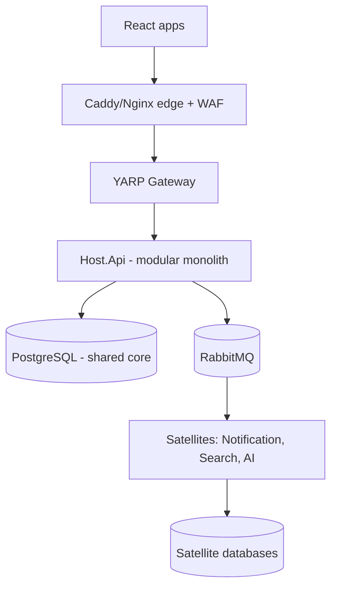

# Master Architecture

**Phase:** 55 (final) · The single-page entry point summarizing the
complete 55-phase documentation program. Every section links to the
detailed phase document(s) that fully specify it — this document is the
map, not a replacement for the territory.

**Stack authority:** `docs/adr/ADR-000-technology-stack-supersession.md`
(core language/DB/messaging), amended by `docs/adr/ADR-021-react-over-angular.md`
(frontend) and `docs/adr/ADR-022-oss-self-hosted-infrastructure-stack.md`
(infrastructure — self-hosted OSS is now the default, Azure a documented
alternative). Workflow execution: `docs/adr/ADR-023-temporal-for-workflow-execution.md`.
**Progress ledger:** `docs/PROGRAM-STATUS.md`.
**AI agent entry point:** `CLAUDE.md`.

---

## 1. Vision

Build a ServiceNow-class enterprise service management platform — one
platform, one data model, one security model, with ITSM/ITAM as the first
product surface — using our own architecture derived from *why* ServiceNow
is built the way it is, not a clone of *how*. Extend the same platform,
later, to IT Operations, and only after that is stable in production, to
non-IT service management (CSM/HRSD-style products), per
`docs/roadmap/implementation-roadmap.md`.

## 2. Goals

- A single, coherent platform kernel (Identity, Tenancy, ACL, Audit,
  Workflow, Notification, Search, Configuration) that every product module
  consumes and none reimplements.
- Enterprise-grade multi-tenancy with a hybrid isolation model matched to
  tenant tier (`docs/architecture/multi-tenancy.md`).
- A defensible security posture (zero trust, defense in depth, full audit)
  from the first line of product code, not retrofitted
  (`docs/security/security-architecture.md`).
- A modular monolith that stays simple until real evidence justifies
  extracting a service (`docs/architecture/microservice-boundary-rules.md`).
- A documentation and rules system complete enough that an AI coding agent
  or a new engineer can implement consistently without inventing
  architecture (`CLAUDE.md`).

## 3. Non-goals (year 1 / this program)

- Cloning ServiceNow's full 200+ SKU catalog — see
  `docs/servicenow-research/product-landscape.md` §7.
- Microservice-per-domain topology — explicitly rejected, ADR-001.
- Full CSM/HRSD/SecOps/GRC/PPM product lines — documented for pattern
  completeness only (`docs/domains/`), built later per
  `docs/roadmap/implementation-roadmap.md` Phases 9–11, if pursued as
  products at all.
- Full AIOps/Discovery/Service Mapping depth — foundation ingest only in
  MVP+1 (`docs/roadmap/mvp.md`).
- Autonomous, unsupervised AI actions — every AI-mutating action requires
  the same authorization a human action would, and high-risk categories
  require human approval (`docs/ai/ai-governance.md`).

## 4. Architecture principles

1. Zero trust at the record — ACL + RLS on every access, no trusted internal
   path (`docs/security/security-architecture.md`).
2. `Task` is the system of work; `CMDB` is the system of record for
   technology — the two root contexts everything else builds on
   (`docs/database/shared-enterprise-data-model.md`).
3. Metadata over hardcoded logic — tables, fields, ACLs, workflows, and
   configuration are data, not code, wherever tenant customization is
   needed.
4. Workflow-as-data, kept strictly separate from synchronous Business Rules
   (`docs/workflow/workflow-engine-architecture.md`, `business-rule-engine.md`).
5. Modular monolith by default; extraction requires an evidenced trigger
   (`docs/architecture/microservice-boundary-rules.md`).
6. Every cross-context effect is API or event, never direct database access
   across a boundary (`docs/architecture/bounded-contexts.md`).
7. Audit and tenancy are enforced identically regardless of which layer
   initiates a call (`docs/architecture/servicenow-layered-architecture.md`).
8. AI is a governed platform capability that can never bypass authorization
   (`docs/ai/ai-governance.md`).

## 5. Product domains

Full inventory and MVP boundary: `docs/servicenow-research/product-landscape.md`,
`docs/architecture/bounded-contexts.md`, `docs/roadmap/mvp.md`.

**MVP:** Identity, Tenant, RBAC/ACL, Audit, Notification (basic), Task,
Workflow, Service Catalog, Knowledge, Incident, Request, Change, CMDB
(foundation), Observability, Integration (basic).

**Documented, deferred:** Problem (next addition post-MVP), full ITAM/ITOM,
Case, Customer, Employee, Security (SecOps), Risk, Compliance, Project,
Portfolio, Vendor, Contract, full AI/Virtual Agent (`docs/domains/`).

## 6. Platform architecture

Full detail: `docs/architecture/target-enterprise-architecture.md` (Phase 4),
all diagrams in `docs/diagrams/` (Phase 42).

## 7. Domain architecture

Bounded contexts, ownership, and cross-context rules:
`docs/architecture/bounded-contexts.md` (Phase 5). Task hierarchy and
EF Core mapping: `docs/domain/task-model.md` (Phase 9). Per-domain profiles:
`docs/domains/*.md` (Phase 40).

## 8. Data architecture

Hybrid database topology (shared core + satellite databases):
`docs/database/database-architecture.md` (Phase 7). Shared foundation
tables: `docs/database/shared-enterprise-data-model.md` (Phase 8). CMDB/CSDM:
`docs/cmdb/` (Phase 10–11). Rules: `docs/rules/database-rules.md` (Phase 33).

## 9. Workflow

`docs/workflow/workflow-engine-architecture.md` (Phase 12),
`business-rule-engine.md` (Phase 13). SLA Engine:
`docs/platform/sla-engine.md` (Phase 49). Service Catalog fulfillment:
`docs/platform/service-catalog.md` (Phase 48).

## 10. Integration

Event-driven architecture (outbox/inbox, RabbitMQ):
`docs/integration/event-driven-architecture.md` (Phase 14). REST/gRPC
rules: `docs/api/rest-grpc-rules.md` (Phase 15). API design:
`docs/api/api-design-rules.md` (Phase 16).

## 11. Security

`docs/security/security-architecture.md` (Phase 17),
`docs/rules/security-rules.md` (Phase 36). Original threat-model detail
(still valid): `docs/architecture/01-security-architecture.md`.

## 12. Multi-tenancy

`docs/architecture/multi-tenancy.md` (Phase 18).

## 13. Audit

`docs/audit/audit-architecture.md` (Phase 19).

## 14. Observability

`docs/observability/observability.md` (Phase 24).

## 15. AI

`docs/ai/ai-architecture.md` (Phase 46), `ai-governance.md` (Phase 47).

## 16. Infrastructure

`docs/infrastructure/self-hosted-production-architecture.md` (Phase 25,
revised) — self-hosted OSS stack (Kubernetes/K3s, PostgreSQL, Valkey,
RabbitMQ, MinIO, OpenSearch, Keycloak, OpenBao, Harbor, Prometheus/Loki/
Tempo/Grafana), per `docs/adr/ADR-022-oss-self-hosted-infrastructure-stack.md`,
with every component individually justified. `docs/azure/production-architecture.md`
retained as a documented alternative deployment target, not the default.

## 17. CI/CD

`docs/devops/cicd.md` (Phase 39).

## 18. Disaster recovery

`docs/architecture/disaster-recovery.md` (Phase 26).

## 19. Governance

`docs/governance/architecture-governance.md` (Phase 50),
`data-governance.md` (Phase 27), `definition-of-done.md` (Phase 54).

## 20. Development rules

`docs/rules/` — coding, database, API, microservice, security, git rules
(Phases 32–37), plus `ai-agent-rules.md` (Phase 52) and `anti-patterns.md`
(Phase 53). Entry point for any coding agent: `CLAUDE.md`.

## 21. Roadmap

`docs/roadmap/implementation-roadmap.md` (Phase 43, 11 sequenced phases),
`docs/roadmap/mvp.md` (Phase 44, the minimum shippable slice).

---

## Final validation

Per the Master AI Command's required consistency review:

| Area | Check | Result |
|---|---|---|
| Architecture | Bounded contexts consistent? Service boundaries justified? Circular dependencies? | Yes — `bounded-contexts.md` cross-context rules + `microservice-boundary-rules.md` evidenced-trigger requirement; no context depends on itself transitively (CMDB/Tenant are the only zero-dependency roots) |
| Database | Every service owns its data? Shared entities correctly modeled? Migrations defined? | Yes — hybrid topology (Phase 7), TPT Task hierarchy (Phase 9), EF Core migrations mandated (Phase 33) |
| APIs | Ownership/contracts clear? REST/gRPC justified? | Yes — three-surface model (Phase 16), gRPC gated by an explicit checklist (Phase 15) |
| Events | Idempotent? Retries/DLQs defined? Outbox defined? | Yes — Phase 14 in full |
| Security | Authorization everywhere? Tenant isolation defined? Audit defined? | Yes — Phase 17–19, restated as binding rules in `docs/rules/security-rules.md` |
| Operations | Logs/metrics/traces defined? Alerts/SLOs defined? | Yes — Phase 24 |
| Infrastructure | Every service justified? Alternatives documented? | Yes — Phase 25's per-component table, with Kubernetes/K3s and RabbitMQ explicitly flagged as the highest-operational-complexity choices, and Azure retained as a documented (non-default) alternative |
| AI | Can AI bypass authorization? Auditable? High-risk protected? | No / Yes / Yes — Phase 46–47, enforced by construction (AI calls the same Domain API commands a human would) |
| Development | Can an AI agent understand the architecture? Rules explicit? Anti-patterns documented? | Yes — `CLAUDE.md` + Phase 52/53 |

## Open items (marked, not hidden)

- `docs/servicenow-research/product-landscape.md` carries several
  `REQUIRES_VALIDATION` markers (exact current ServiceNow SKU boundaries in
  Finance/Supply Chain, multi-instance architecture citation) — to be
  confirmed against live ServiceNow documentation before being treated as
  locked fact, per the Phase 0 research discipline.
- ADR-004/ADR-016 (RabbitMQ) is accepted but explicitly flagged for
  re-evaluation against Azure Service Bus once real operational data
  exists.
- Search (ADR-014) and the deferred CSDM Technology Service layer
  (Phase 10) both have named, evidence-based migration/adoption triggers
  rather than being permanently fixed decisions.
- `docs/ENTERPRISE_ITSM_IMPLEMENTATION_GUIDE.md` remains in the repository
  as the original guide; its stack specifics are superseded (ADR-000), its
  wave/process thinking is carried forward — a future pass should either
  formally retire it or reconcile it fully into this document.

---

*This is the final document of the 55-phase program. See
`docs/PROGRAM-STATUS.md` for the complete phase-by-phase delivery ledger.*
