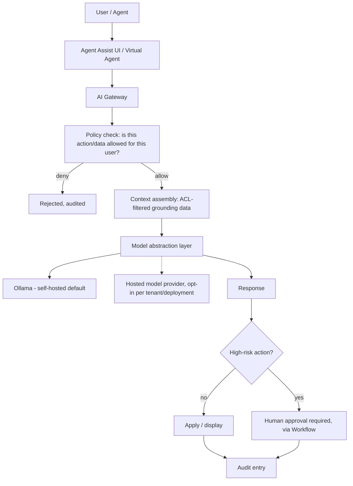

# AI Architecture

**Phase:** 46 · Researched against ServiceNow's AI Platform layer (Phase 1:
generative assistance, autonomous agents, an AI Control Tower governing
usage/policy/risk, a Context Engine grounding decisions in real operational
data) — we derive our own, smaller-scope architecture from the same
principle: **AI is a governed platform capability, not a per-feature
bolt-on.**

## Critical principle (restated from the Master AI Command, non-negotiable)

**AI must NEVER bypass existing authorization.** Every architectural
decision below exists in service of that one sentence.

## Components

## AI Gateway

- Every AI call — from any module, any UI surface — goes through **one**
  internal AI Gateway, never a direct SDK call scattered across the
  codebase. This is the enforcement point for the policy check, the audit
  entry, and the model-abstraction indirection.

## Model abstraction

- An `IModelProvider` interface abstracts the specific model/vendor
  (**Ollama**, self-hosted, as the default per
  `docs/adr/ADR-022-oss-self-hosted-infrastructure-stack.md`; a hosted
  provider remains pluggable per tenant/deployment for those wanting a
  larger model than is practical to self-host); no calling code depends on
  a vendor-specific SDK directly — matches the same provider-abstraction
  discipline used for Notification channels (Phase 20)
  and Search backends (Phase 21).

## Context Engine (our version)

- Grounding context (the data an AI feature reasons over) is assembled
  **server-side, after ACL filtering** — never client-assembled, never a
  raw "give the model access to the database" pattern.
- Sources: Knowledge (Published, ACL-visible articles only, per
  `knowledge-management.md`), the specific record(s) the user already has
  access to view, and CMDB context relevant to that record — the same
  three-layer defense (ACL → tenant filter → RLS) that gates every other
  data access gates this too, applied before the data ever reaches a
  prompt.

## RAG (Retrieval-Augmented Generation)

- Retrieval queries the Search platform (Phase 21) with the requesting
  user's ACL/tenant scope applied as a hard filter, not a prompt
  instruction — "only use tenant X's data" as a system-prompt instruction
  alone is not a security control and is never relied upon as one.
- Embeddings/vector search: **Qdrant**, per
  `docs/adr/ADR-022-oss-self-hosted-infrastructure-stack.md` — supersedes
  the earlier "evaluate `pgvector` first" plan, since Qdrant is already the
  named default rather than something to justify standing up later.
  Collections are tenant-scoped (or a shared collection with a mandatory
  tenant filter, matching the OpenSearch pattern in
  `docs/platform/search-architecture.md`), and retrieval still applies the
  ACL pre-filter described above before any vector similarity search runs.

## Tool calling / agent orchestration

- AI "actions" (e.g. "resolve this incident," "draft this article") are
  implemented as calls into the **exact same Domain API / Application-layer
  commands** a human-driven UI action would call — never a privileged,
  AI-only code path. This is the concrete mechanism that makes "AI must
  never bypass authorization" true by construction rather than by
  discipline alone.
- Agent orchestration (multi-step AI-driven sequences) reuses the Workflow
  engine (Phase 12) for anything resembling a multi-step process — not a
  separate agent-orchestration framework duplicating Workflow's job.

## Prompt injection protection

- User-supplied and retrieved content (knowledge articles, ticket text) is
  never concatenated into a system prompt with elevated trust — it is
  clearly delineated as untrusted input, and any tool-calling capability
  exposed to a model is scoped to exactly the actions the *requesting
  user* — not the model — is authorized to take (the policy check in the
  diagram above evaluates the human user's permissions, not "does the AI
  think this is a good idea").

## PII handling

- `Confidential`/`Restricted`-classified fields (`docs/governance/data-governance.md`)
  are excluded from prompts and from any data sent to an external model
  provider, by construction (filtered at context-assembly time), not by
  prompting the model not to use them.

## Human approval and AI action boundaries

- Every AI-suggested action that **mutates data** requires the same
  authorization check a human-triggered action would (§ above), **and**
  high-risk categories (declaring a major incident, closing a change,
  anything affecting more than one record) require explicit human approval
  via the standard Workflow `Approval` activity before applying — AI output
  is a suggestion feeding a human decision or a Workflow gate, never an
  autonomous write path for high-risk actions.

## Audit

- Every AI Gateway call (prompt, retrieved context references, model
  response, and any resulting action) is logged with the same audit
  discipline as any other mutating operation (Phase 19) — prompts/tool
  calls are observable for later review, not a black box.

---

*Next: `docs/ai/ai-governance.md` (Phase 47).*
