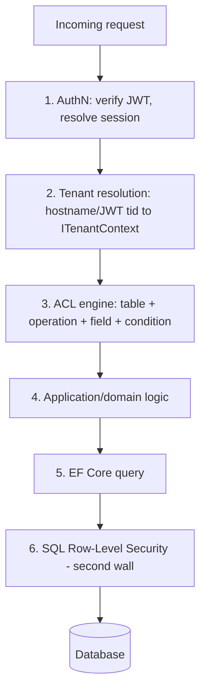

# 01 — Security Architecture

**Status:** Locked baseline. Changes require an ADR under `docs/adr/` and security-owner sign-off.

**Applies to:** every module, every wave. Wave 0 exit criteria requires the
threat model in §1 to exist; Wave 1 exit criteria requires §3–§5 implemented
and isolation-tested before any ITSM screen ships.

**Relates to:** [Master guide §5](../ENTERPRISE_ITSM_IMPLEMENTATION_GUIDE.md#5-platform-principles-constitution)
(constitution), [§10](../ENTERPRISE_ITSM_IMPLEMENTATION_GUIDE.md#10-security-compliance-and-operations)
(checklist this document expands), and
[`02-tenancy-and-data-isolation.md`](02-tenancy-and-data-isolation.md) (RLS
mechanics live there; this document owns the *policy*, that one owns the
*implementation*).

---

## 0. Security principles (non-negotiable)

1. **Zero trust at the record.** Every read/write is authenticated, tenant-resolved, and ACL-evaluated — no endpoint is "internal-only trusted."
2. **Fail closed.** Missing tenant context, missing role, missing ACL rule, or an evaluation error all deny access. Never default-allow.
3. **Defense in depth.** Application-layer ACL is never the only wall — SQL Row-Level Security backs every shared-tenant table.
4. **Least privilege by default.** New roles start with zero grants; every capability is explicitly granted, never implicitly inherited from "admin-like" roles.
5. **Everything is audited.** Every mutation, every impersonation, every permission change, every export is attributable to a user, tenant, and correlation ID, and is immutable once written.
6. **Secrets never live in code, config files, or the repo.** Vault-issued, short-lived where possible.
7. **Security is a CI gate, not a review comment.** SAST, dependency scan, container scan, and architecture tests fail the build — they are not advisory.

---

## 1. Threat model

### 1.1 Assets to protect

| Asset | Why it matters |
|---|---|
| Tenant business data (tickets, CMDB, knowledge, attachments) | Confidentiality breach = contract-ending event for a SaaS ITSM vendor |
| Credentials & session tokens | Account takeover → full tenant compromise |
| Audit trail | Tampering defeats compliance and incident forensics |
| Platform metadata (ACLs, workflow definitions) | Attacker who edits an ACL can grant themselves access silently |
| Encryption keys / secrets | Compromise defeats every other control |
| Availability of the platform | ITSM is the tool used to respond to *other* incidents — downtime compounds customer outages |

### 1.2 Actors

| Actor | Capability | Primary risk |
|---|---|---|
| External unauthenticated attacker | Internet access to public endpoints | Injection, auth bypass, enumeration, DoS |
| Authenticated end user (employee) | Valid session, low privilege | Privilege escalation, IDOR, cross-tenant leakage |
| Authenticated agent/admin | Elevated privilege within one tenant | Insider misuse, over-broad ACL, impersonation abuse |
| Compromised tenant | Malicious or breached customer account | Attempted cross-tenant pivot, data exfiltration at scale (API scraping) |
| Malicious integration / API consumer | API key or OAuth client | Rate abuse, over-permissioned scope, replay |
| Insider (platform engineer/operator) | Production/DB access | Direct data access bypassing app-layer ACL — this is why RLS exists |
| Supply chain | NuGet/npm dependency, base image | Malicious package, vulnerable transitive dependency |

### 1.3 STRIDE summary (platform-level)

| Threat | Primary controls |
|---|---|
| **S**poofing | OIDC/SAML federation, MFA via IdP, short-lived JWTs, mTLS for service-to-service |
| **T**ampering | Immutable audit log, signed webhooks, integrity-checked file storage, DB constraints |
| **R**epudiation | Audit stream with actor + tenant + correlation ID on every mutation |
| **I**nformation disclosure | ACL + RLS dual wall, field-level strip, tenant-partitioned search/cache/blob, encryption at rest/in transit |
| **D**enial of service | Per-tenant rate limits, connection pool quotas, circuit breakers, WAF at gateway |
| **E**levation of privilege | Explicit-grant roles, condition-based ACLs, no client-trusted role claims (server re-resolves), impersonation fully audited and scoped |

### 1.4 Top abuse cases to test every wave

- Tenant A crafts a request with Tenant B's record ID → must 403/404, never 200 with data.
- User with `role=agent` but no ACL grant on `Change` table attempts direct Table API write → denied, audited as attempt.
- Expired/replayed JWT reused against Domain API → rejected.
- Attachment upload with executable payload renamed `.pdf` → virus/type scan blocks it.
- Search query crafted to pivot across tenant-partitioned OpenSearch index → index alias enforces tenant scope; query cannot override it.
- AI/RAG prompt injection attempting to retrieve another tenant's knowledge article → grounding context is pre-filtered server-side, never trusts the prompt.

**Threat model review cadence:** revisited and re-signed at the start of every wave that introduces a new trust boundary (new API surface, new integration type, AI/RAG in Wave 7).

---

## 2. Identity & authentication

### 2.1 Supported identity sources

| Source | Use case | Protocol |
|---|---|---|
| Enterprise IdP (Entra ID, Okta, generic) | Tenant SSO for employees/agents | OpenID Connect (primary), SAML 2.0 (legacy enterprise) |
| Platform local identity | Small tenants without an IdP, break-glass admin | Password + mandatory MFA (TOTP/WebAuthn) |
| API clients | Integrations, MID agent, service-to-service | OAuth 2.0 client-credentials, scoped tokens; mTLS for internal satellite processes |

### 2.2 Session & token rules

- **Access tokens are short-lived JWTs** (target 10–15 min), signed by the platform's own token service after OIDC/SAML federation completes — the IdP token is exchanged, never forwarded raw to downstream APIs.
- **Refresh tokens** are rotated on use (rotation-on-refresh), bound to a session record that can be revoked server-side (logout, admin-forced revoke, tenant offboarding).
- **BFF sessions (React apps)** use an HttpOnly, Secure, SameSite=Lax (or Strict where flows allow) cookie; the SPA never holds the JWT in `localStorage`.
- **Claims embedded:** `sub`, `tid` (tenant id), `roles`, `sid` (session id), `amr` (auth method — needed to enforce "sensitive action requires MFA-verified session").
- **Server never trusts client-asserted roles.** `roles` in the JWT are informational for UI; every API call re-resolves effective permissions from the ACL engine against current DB state, so a role revoked mid-session takes effect on the next call, not at next login.
- MFA is **mandatory** for: local-identity admins, impersonation, any break-glass access, and API-key generation.

### 2.3 Impersonation

- Always requires an explicit reason code, is time-boxed (default 30 min, configurable per tenant policy), and produces a dedicated audit event (`ImpersonationStarted` / `ImpersonationEnded`) distinguishable from normal activity.
- The impersonated session's every subsequent audit entry is tagged with **both** the acting admin and the impersonated user.
- Tenants can disable impersonation entirely via a tenant security policy flag (required for some regulated customers).

---

## 3. Authorization model

### 3.1 Layers (defense in depth)

If any layer denies, the request stops there — layers are not "belt and
suspenders that trust each other," each one is written as if the others do
not exist.

### 3.2 Role model

- **Roles** (RBAC) grant coarse capability (`itil_agent`, `catalog_admin`, `security_admin`, `tenant_admin`, `api_integration`).
- **ACL rules** (ABAC-flavored) narrow role capability to table/operation/field/condition, matching the ServiceNow ACL pattern:

| ACL field | Meaning |
|---|---|
| `Table` | Target table, or `*` for a role-wide default |
| `Operation` | `read` / `write` / `create` / `delete` |
| `RequiredRoles` | One of these roles must be present |
| `Condition` | Server-evaluated predicate (e.g. `record.AssignmentGroup in user.Groups`, `record.CreatedBy == user.Id`) |
| `Field` | Optional — if set, rule governs a single field, not the whole row |
| `Effect` | `Allow` / `Deny` (explicit `Deny` always wins over any `Allow`) |

- Evaluation order: gather all matching rules for (tenant, table, operation, field) → if any `Deny` matches, deny → else require at least one matching `Allow` → else deny (fail closed).
- **Field-level ACLs** strip forbidden fields from the response rather than 403-ing the whole record, mirroring ServiceNow's read behavior — this lets a form render partial data for lower-privilege viewers.
- ACL rules are **metadata**, editable in Admin Studio, versioned, and themselves ACL-protected (only `security_admin` can edit ACLs — an unprivileged user must not be able to grant themselves access by editing a rule).

### 3.3 Row-Level Security (second wall)

- Every shared-tenant table has a SQL Server RLS security policy filtering on `TenantId = SESSION_CONTEXT('TenantId')`.
- `SESSION_CONTEXT` is set by the EF Core connection interceptor immediately after opening a connection, from `ITenantContext`, and the interceptor **throws before executing any command** if tenant context is unset ("fail closed", not "default to no filter").
- RLS exists specifically to protect against the case where application-layer ACL logic has a bug, a new endpoint forgets to check ACL, or a direct DB access path (reporting tool, ad-hoc query, insider) bypasses the app entirely.
- Full implementation (connection factory, interceptor code shape, RLS DDL, dedicated-DB tenant handling) lives in `02-tenancy-and-data-isolation.md`; this document owns the requirement, not the mechanics.

### 3.4 API keys & service accounts

- Scoped to specific Table/Domain API resources and operations, never a blanket "full access" key by default.
- Stored hashed; shown once at creation.
- Rotatable and revocable without disabling the whole integration; expiry enforced (default max 1 year, tenant-configurable shorter).
- Every API-key-authenticated call is attributed to a synthetic service identity for audit, never anonymized as "system."

---

## 4. Data protection

### 4.1 Encryption

| Layer | Requirement |
|---|---|
| In transit | TLS 1.2+ everywhere (public and internal); HSTS on all public endpoints; mTLS between `Host.Api` and satellite workers where they cross a network boundary |
| At rest — database | Transparent Data Encryption (TDE) minimum on all tenant databases |
| At rest — field-level | Optional column-level encryption for designated PII/sensitive fields, available as an enterprise-tier feature; encryption keys are tenant-scoped |
| At rest — blob storage | Provider-managed encryption at rest minimum; tenant-prefixed containers/paths |
| At rest — backups | Same encryption standard as source; backup access audited separately from production access |
| Key management | Azure Key Vault / HashiCorp Vault; application never stores raw keys; key rotation is a documented runbook, not a manual one-off |

### 4.2 Data classification

Every field in the metadata store carries a classification tag used to drive
UI masking, export controls, and AI grounding eligibility:

| Classification | Examples | Handling |
|---|---|---|
| `Public` | Catalog item names | No restriction |
| `Internal` | Ticket short description | Tenant-scoped only |
| `Confidential` | Employee PII, salary-adjacent HR fields (Wave 8) | Field-level ACL required; masked in exports by default |
| `Restricted` | Credentials, tokens, secrets accidentally pasted into fields | Never logged, never sent to AI providers, redaction scan on ingestion where feasible |

### 4.3 Attachments & files

- Virus/malware scan on upload before the file is retrievable (quarantine bucket → scan → promote or reject).
- Content-type sniffing, not filename-trust, decides how a file is served (prevents disguised-executable attacks).
- Every blob path is tenant-prefixed; access requires the same ACL check as the record it's attached to, re-checked on every download, not cached from upload time.
- Signed, short-lived URLs for direct-to-blob download; the app never proxies large files through `Host.Api` unnecessarily.

### 4.4 Secrets management

- All secrets (DB credentials, signing keys, third-party API keys, SMTP creds) live in Key Vault/Vault, injected at runtime — never in `appsettings.json`, environment files committed to the repo, or CI logs.
- CI pipeline uses short-lived, scoped deployment credentials, not long-lived shared secrets.
- Pre-commit/CI secret-scanning (e.g. gitleaks-class tooling) blocks a merge that introduces a credential-shaped string.

---

## 5. Network & application security

### 5.1 Perimeter

- Gateway (YARP / Azure Front Door / APIM) terminates TLS, applies WAF rules, and enforces per-tenant rate limits before traffic reaches `Host.Api`.
- CORS is deny-by-default; allowed origins are explicit per environment, never `*` with credentials.
- CSRF protection required on every cookie-authenticated (BFF) endpoint; token-authenticated (Table/Domain API with bearer tokens) endpoints are inherently CSRF-safe but still validate `Origin`/`Referer` where applicable.

### 5.2 Input handling

- All inputs validated with FluentValidation at the Application layer boundary — never trust client-side validation alone.
- Parameterized queries only; EF Core LINQ by default, raw SQL forbidden without an explicit review exception and parameterization proof.
- Table API's dynamic query language (filters, sort) is parsed into a typed expression tree server-side — it never concatenates user input into SQL text.
- Output encoding for any HTML-rendering surface (knowledge articles, rich-text fields) uses a sanitizer allow-list, not a blocklist.

### 5.3 Rate limiting & DoS protection

- Per-tenant and per-API-key quotas at the gateway, with burst + sustained limits.
- Expensive operations (bulk export, report generation, discovery ingest) run through the async worker path with backpressure, never synchronously on the request thread.
- Noisy-neighbor isolation: one tenant's load spike must not degrade another tenant's latency on shared infrastructure — enforced via connection pool partitioning and queue-level fairness, verified under Wave 5+ load tests.

### 5.4 Dependency & supply chain security

- Automated SAST on every PR (build-blocking on high/critical).
- Dependency vulnerability scanning (NuGet + npm) on every PR and nightly against `main`.
- Container image scanning before any deploy; base images pinned and patched on a scheduled cadence, not ad hoc.
- Lockfiles committed (`package-lock.json`, `packages.lock.json`); no floating version ranges in production dependencies.

---

## 6. Audit & observability

### 6.1 Audit log requirements

Every mutating operation writes an immutable audit entry containing:

| Field | Purpose |
|---|---|
| `TenantId` | Isolation and query scoping |
| `ActorUserId` (+ `ImpersonatedByUserId` if applicable) | Attribution |
| `Action` | e.g. `Incident.Resolve`, `ACL.Update`, `User.RoleGranted` |
| `TargetTable` / `TargetId` | What changed |
| `OldValue` / `NewValue` | Field-level diff where applicable |
| `CorrelationId` | Ties together a distributed trace across API → workflow → workers |
| `Timestamp` | UTC, server-generated (never client-supplied) |
| `SourceIp` / `Channel` | UI, API, integration, MID agent |

- Audit records are **append-only**: no update/delete path exists in the application layer; retention/immutability enforced at the storage layer (e.g. append-only blob tier or DB-level trigger denial of UPDATE/DELETE) for regulated tenants.
- Security-sensitive audit categories (ACL changes, role grants, impersonation, key rotation, data export) are surfaced in a dedicated Admin Studio security log view, separate from general activity streams.

### 6.2 Observability as a security control

- OpenTelemetry traces/metrics/logs from Wave 1 (see `07-devops-observability.md`), because detection depends on visibility existing before an incident, not being retrofitted after one.
- Alerting on anomalous patterns: spike in 403s from one identity, spike in cross-tenant-shaped query attempts caught by RLS, repeated failed auth from one source, impersonation outside business hours.

---

## 7. Secure development lifecycle

| Stage | Control |
|---|---|
| Design | Threat model updated for any new trust boundary (§1.4) before implementation starts |
| Code | Analyzers + NetArchTest enforce architecture boundaries that double as security boundaries (Domain has no HTTP/EF, no module reaches into another module's Infrastructure) |
| PR | SAST + dependency scan + secret scan block merge on high/critical findings |
| Pre-deploy | Container scan; migration review for any RLS/ACL-adjacent schema change requires security-owner approval |
| Runtime | Rate limiting, WAF, audit logging active in every environment including `dev` (so isolation/audit tests are meaningful) |
| Periodic | Access reviews (who has `security_admin`/`tenant_admin`), key rotation runbook exercised, dependency patch cadence |
| Pre-GA | External penetration test gate before first paying production tenant (master guide §10.2) |

---

## 8. Compliance posture

- Target framework alignment: **SOC 2 Type II** and **ISO 27001**-oriented controls from Wave 1 onward (access reviews, change management, audit immutability), not bolted on later.
- **GDPR/data-subject rights:** classification (§4.2) plus a documented export/delete path per tenant is required before any tenant holds EU personal data in production.
- **Tenant offboarding:** crypto-shred (destroy tenant-scoped encryption keys) plus a legal-hold override path, documented as a runbook (see `07-devops-observability.md`).
- Backup and DR strategy differs by isolation mode (shared vs dedicated DB) and is documented per tenant tier.

---

## 9. Checklist (maps to master guide waves)

**Wave 0 exit** (documented, not yet implemented):
- [ ] Threat model (§1) written and reviewed by security owner.
- [ ] Secure SDLC gates (§7) wired into CI (SAST, dependency scan, container scan, secret scan).

**Wave 1 exit** (implemented and isolation-tested):
- [ ] AuthN via OIDC/SAML + local identity with mandatory MFA paths (§2).
- [ ] ACL engine enforcing table/operation/field/condition (§3.2) on Table API.
- [ ] SQL RLS policies live on every shared-tenant table; fail-closed tenant interceptor (§3.3).
- [ ] Immutable audit stream (§6.1) covering all Task engine and ACL mutations.
- [ ] Impersonation implemented with full audit trail and time-boxing (§2.3).
- [ ] Automated isolation + ACL-matrix tests green (owned in detail by `08-testing-qa-strategy.md`).

**Wave 3+ (ongoing, every wave that adds a table/API):**
- [ ] New tables get default ACL rules and RLS coverage before shipping — never additive-only "we'll lock it down later."
- [ ] New public API surfaces reviewed against §5 before contract freeze.

**Wave 5+ (integrations):**
- [ ] API keys scoped and rotatable (§3.4); rate limits enforced per tenant/key (§5.3).
- [ ] Secrets for third-party integrations in Key Vault/Vault, not tenant-editable config text (§4.4).

**Wave 7 (AI):**
- [ ] RAG grounding pre-filtered server-side by tenant and field classification (§4.2, §1.4) — adversarial cross-tenant retrieval tests green before enabling for any tenant.
- [ ] AI provider calls exclude `Restricted`-classified fields (§4.2) by construction, not by prompt instruction alone.

---

## 10. References

- [Master guide §5 Platform principles](../ENTERPRISE_ITSM_IMPLEMENTATION_GUIDE.md#5-platform-principles-constitution)
- [Master guide §10 Security, compliance, operations](../ENTERPRISE_ITSM_IMPLEMENTATION_GUIDE.md#10-security-compliance-and-operations)
- [ServiceNow Docs](https://www.servicenow.com/docs) — ACL and application scope model this design mirrors
- OWASP ASVS (Application Security Verification Standard) — baseline for §5 control depth
- NIST SP 800-53 / SOC 2 Trust Services Criteria — baseline for §8 compliance posture

---

*Next in sequence: `02-tenancy-and-data-isolation.md` — the implementation mechanics behind §3.3.*
