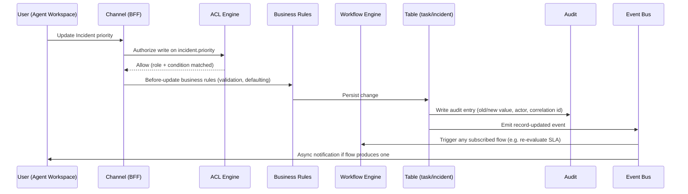

# ServiceNow Layered Architecture — Request Path & Cross-Cutting Concerns

**Phase:** 3 (companion to `servicenow-reference-architecture.md`). Where
that document explains each layer in isolation, this one traces **one
request through all of them** and shows where security, audit, and
observability actually attach — because in ServiceNow (and in any platform
built this way) those are not a layer, they're a thread running through
every layer.

## A single request's path

Every one of these steps happens **regardless of which layer of the
reference architecture initiated the call** — a Scripted REST API call from
an external integration goes through the identical ACL → Business Rule →
Table → Audit → Event path as a UI form submit. This is the actual meaning
of "zero trust at the record": **the enforcement point is the table, not the
caller's layer.**

## Where each cross-cutting concern attaches

| Concern | Attachment point | Why there, not elsewhere |
|---|---|---|
| **Authentication** | Channel/API entry (once per request) | No layer below trusts a caller-asserted identity — it's resolved once and carried as context |
| **Authorization (ACL)** | Immediately before any table read/write, at every layer that touches data | An integration calling Scripted REST must clear the same bar as a UI form — no privileged internal path |
| **Domain/tenant separation** | Table access layer (query augmentation) | Every query is scoped before it reaches storage, not filtered after |
| **Business rules / validation** | Before/after table write | Runs regardless of caller (UI, API, workflow, integration) — a script can't be bypassed by calling a different entry point |
| **Audit** | Table write | Captures the actual persisted change, not the request intent — protects against a business rule silently altering the value that gets audited |
| **Events** | Table write (after commit) | Downstream consumers (workflow, search index, notification) react to what actually happened, not to the request |
| **Observability (trace/correlation id)** | Generated at channel entry, propagated through every subsequent call | Lets one user action be traced through ACL → business rule → workflow → notification as one causal chain |

## Why this matters for our derived architecture

The Master AI Command's Phase 17 (security) and Phase 19 (audit) are not
separate concerns from Phase 4 (target architecture) — they are properties
that must be true **at every layer**, not bolted onto one layer. Concretely:

- Our gRPC internal service-to-service calls must carry the same
  authorization context as REST calls from React — no "internal calls are
  implicitly trusted" shortcut (this is exactly the mistake ServiceNow's
  design avoids by enforcing ACL at the table, not the channel).
- Our audit log must be written from the same transaction that persists the
  business change, not queued optimistically before the write succeeds.
- Our workflow engine must react to committed domain events, not to
  in-flight request intent, so a rolled-back transaction never triggers a
  downstream side effect.

These constraints are carried forward as hard requirements into
`target-enterprise-architecture.md` (Phase 4) and `event-driven-architecture.md`
(Phase 14).

---

*Next: `target-enterprise-architecture.md` (Phase 4) — our own derived
architecture.*
