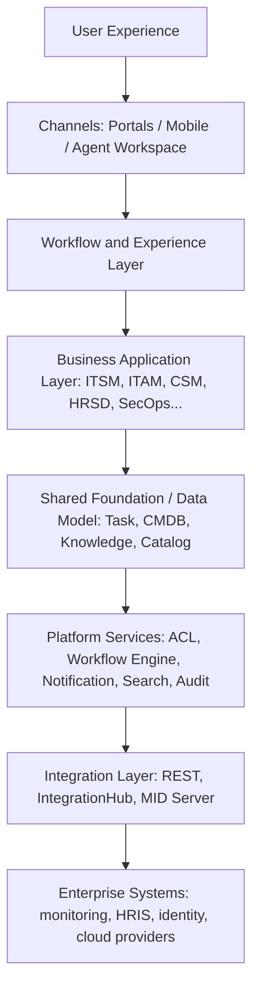

# ServiceNow Reference Architecture (Reverse-Engineered)

**Phase:** 3 · This document explains **what ServiceNow's conceptual
architecture is**, derived from the platform documentation and research in
`docs/servicenow-research/`. It is descriptive of ServiceNow, not
prescriptive for us — `target-enterprise-architecture.md` (Phase 4) is where
we derive our own design from the lessons here.

## The layered model

## Layer-by-layer explanation

### 1. User Experience
The rendered surface a human interacts with: forms, lists, dashboards,
conversational UI. ServiceNow deliberately keeps this thin — presentation
logic, not business logic, lives here. **Lesson:** business rules that live
in the UI layer are an anti-pattern regardless of platform (see
`docs/rules/anti-patterns.md`).

### 2. Channels: Portals / Mobile / Agent Workspace
Three distinct experience shells consume the same underlying data/workflow:
**Employee Center** (self-service portal), **mobile app** (push-capable,
on-the-go), **Agent Workspace** (dense, contextual, built for high-volume
professional users). Each channel is a different *view*, not a different
*backend* — they all call the same platform APIs. **Lesson:** never let a
channel own its own copy of business logic; one BFF/API surface, many
front-ends.

### 3. Workflow & Experience Layer
Flow Designer, Workflow, Approvals, notifications-as-workflow-steps. This is
where "what happens next" is defined **as data** (a versioned flow
definition), not as compiled code branching on record state. **Lesson:**
this is the strongest, most consistently repeated architectural decision in
the entire platform — carried into our Phase 12 workflow engine design
without dilution.

### 4. Business Application Layer
ITSM, ITAM, CSM, HRSD, SecOps, etc. — each is a set of tables, forms, and
workflows layered on the shared foundation, scoped by "application scope"
(a namespace, not a network boundary). **Lesson:** application scope gives
modular *code and data namespacing* inside one platform, not microservice
isolation — this is the single biggest reason ServiceNow does not run each
product as a separate deployable, and the same reasoning applies to us
(Phase 6).

### 5. Shared Foundation / Data Model
`task` (base for Incident/Problem/Change/Request/Case), CMDB (CI +
relationships), Knowledge, Catalog, `sys_user`/`sys_group` — the tables
every application layer product extends or references rather than
reinventing. **Lesson:** this is the layer that makes cross-product queries
(an incident's affected CI, a case's entitlement) cheap, because they're
joins within one schema, not calls across service boundaries.

### 6. Platform Services
ACL engine, Workflow engine runtime, Notification delivery, Search
indexing, Audit logging, Business Rules execution. These are horizontal
capabilities every application layer product consumes identically — no
product reimplements its own authorization or its own audit trail.
**Lesson:** these are exactly the platform-kernel capabilities we scoped in
our earlier `01-security-architecture.md` and `09-notification-...md`, now
re-derived independently from ServiceNow's own layering — strong convergent
evidence this is the right kernel boundary.

### 7. Integration Layer
Table API, Scripted REST APIs, IntegrationHub spokes, and the **MID
Server** (an on-premises agent for reaching internal networks the SaaS
instance cannot directly reach — used by Discovery, Orchestration,
on-prem integrations). **Lesson:** the MID Server pattern — a
customer-network-resident satellite process the SaaS core talks to over an
outbound-only connection — is the correct model for any capability that must
run inside a customer's network (discovery, on-prem system integration); we
should not attempt to reach into customer networks from our own cloud.

### 8. Enterprise Systems
Everything ServiceNow integrates with but does not own: monitoring tools,
identity providers, HRIS, cloud provider APIs, ITSM-adjacent tools (Jira,
Slack/Teams). **Lesson:** the platform's job stops at a clean, versioned
integration contract — it does not try to become every system it talks to.

---

## Cross-cutting fact this diagram doesn't show

Security (ACL + role), tenancy/domain separation, and audit are not a
"layer" — they are enforced **at every layer**, on every table access,
regardless of which layer initiated the call. This is expanded in
`servicenow-layered-architecture.md`.

---

*Next: `servicenow-layered-architecture.md` — the same architecture viewed
as a request's actual path through the system, plus where security/audit
attach.*
