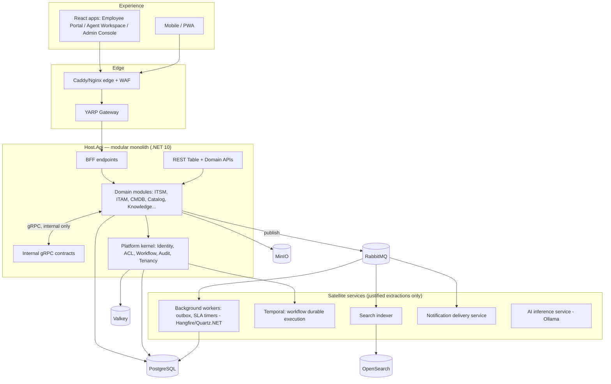

# Target Enterprise Architecture

**Phase:** 4 · Supersedes the stack in `ENTERPRISE_ITSM_IMPLEMENTATION_GUIDE.md`
per `docs/adr/ADR-000-technology-stack-supersession.md`. This is **our**
architecture — inspired by the ServiceNow patterns documented in Phase 1–3,
not a clone of them.

## Locked technology decisions

| Layer | Decision | Rationale (why, not just what) |
|---|---|---|
| Backend | ASP.NET Core / .NET 10 Web API | Mature, high-performance, first-class async, strong typing for a large domain model |
| Frontend | React + TypeScript | Large ecosystem, hooks-based composition, and TanStack Query/React Router give a clear enough convention set for a large multi-team enterprise app when paired with the explicit structure in `docs/frontend/react-architecture.md` (per `ADR-021-react-over-angular.md`) |
| Database | PostgreSQL | Open, strong RLS support, JSONB for metadata-driven fields, mature partitioning, avoids licensing cost/lock-in of a proprietary RDBMS at enterprise scale |
| Cache | Valkey | Session/state cache, distributed locks, rate-limit counters — self-hosted, Redis-protocol-compatible per `ADR-022` |
| Messaging | RabbitMQ | Mature AMQP broker; supports the outbox/inbox + DLQ patterns we require without a cloud-managed dependency |
| API style | REST (external/UI) + gRPC (internal service-to-service, where justified) | REST for broad compatibility and React/partner consumption; gRPC only where low-latency typed internal calls pay for the added complexity — see `docs/api/rest-grpc-rules.md` |
| AuthN/AuthZ | OAuth2 / OIDC + JWT (Keycloak) | Standards-based federation; JWT for stateless API authorization; Keycloak as the self-hosted IdP per `ADR-022` |
| Observability | OpenTelemetry → Prometheus / Grafana Loki / Grafana Tempo / Grafana OSS | Vendor-neutral instrumentation, self-hosted backend per `ADR-022`/`ADR-018` amendment |
| Containerization | Docker | Standard packaging for all environments |
| Infrastructure | Self-hosted, cloud-agnostic (Kubernetes/K3s) | Per `docs/adr/ADR-022-oss-self-hosted-infrastructure-stack.md` — supersedes the original Azure-only decision; Azure remains a documented alternative deployment target |
| CI/CD | Jenkins or Gitea Actions (against Gitea) | Self-hosted per `ADR-022`; final pick between the two pending a follow-up ADR |
| Service topology | Modular monolith + microservices where justified | See `microservice-boundary-rules.md` (Phase 6) |

## What we take from ServiceNow's architecture (Phase 1–3 findings)

1. **One data model, one security model, reused across all products** — not
   per-product schemas or per-product auth.
2. **`Task` (and `Case`) as a shared base** for anything that represents
   "work to be done and tracked" — Incident, Problem, Change, Request,
   HR Case, etc. all extend it.
3. **CMDB as an independent root system of record**, read by many products,
   owned by none of them.
4. **Application scope = code/data namespacing inside one platform**, not
   network isolation — this is *why* ServiceNow does not run
   Incident/Problem/Change as separate deployables, and *why* we won't
   either (Phase 6).
5. **Workflow-as-data**, not workflow-as-code-branches.
6. **Security/audit enforced at the data-access boundary**, identical for
   every calling layer (UI, API, integration, workflow) — see
   `servicenow-layered-architecture.md`.
7. **A satellite-agent pattern (MID Server analog)** for anything that must
   execute inside a customer's network, rather than the cloud core reaching
   in.

## What we explicitly do NOT take

- Proprietary implementation details of ServiceNow's runtime (its specific
  scripting engine, its internal storage engine, its exact ACL syntax) —
  those are implementation, not principle.
- The full multi-decade product catalog — see `mvp.md` (Phase 44) for our
  actual scope.
- Microservice-per-product — ServiceNow itself doesn't do this; neither do we
  (Phase 6).

## Our layered architecture

## Unified capabilities (platform kernel — every product consumes, none reimplements)

| Capability | Owned by | Consumed by |
|---|---|---|
| Identity & authentication | Platform kernel | Every module, every channel |
| Authorization (RBAC + ABAC/ACL + RLS) | Platform kernel | Every table access, every API |
| Audit | Platform kernel | Every mutating operation |
| Notification | Notification service (satellite) | Any module that needs to reach a human |
| Search | Search indexer (satellite) + kernel query interface | Knowledge, Catalog, CMDB, Task records |
| Configuration (incl. feature flags, tenant config) | Platform kernel | Every module, every environment |
| Tenant / organization model | Platform kernel | Every table, every query |
| Service Catalog | Platform kernel capability, ITSM/HR/etc. are consumers | Request fulfillment across departments |
| Knowledge | Platform kernel capability | Portal search, agent assist, AI grounding |
| Reporting / analytics | Platform kernel (query layer) + product-specific dashboards | All modules |
| Integration (inbound/outbound, webhooks) | Platform kernel (Integration fabric) | All modules, external systems |
| Observability | Cross-cutting (OpenTelemetry from every process) | Everything |

**Rule:** a module must never reimplement any row in this table. If a module
"needs its own notification logic" or "its own audit," that is a defect to
fix, not a feature to build — see `docs/rules/anti-patterns.md`.

## Deployment topology principle

We run **one API host process** (`Host.Api`, modular monolith) plus a small,
explicitly justified set of satellite services (background workers, search
indexer, notification delivery, AI inference) — matching the pattern
ServiceNow itself follows (Phase 3) and matching Rule 1/4 of the Master AI
Command (don't assume every domain needs a microservice; prefer simplicity
unless complexity earns its keep). Extraction criteria for a *new* satellite
service are defined formally in `microservice-boundary-rules.md`.

---

*Next: `bounded-contexts.md` (Phase 5).*
