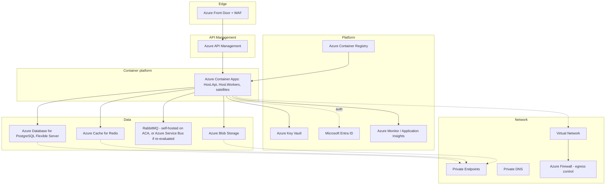

# Azure Production Architecture — Documented Alternative

**Status:** Superseded as the default by
`docs/infrastructure/self-hosted-production-architecture.md`, per
`docs/adr/ADR-022-oss-self-hosted-infrastructure-stack.md`. Kept as a
documented alternative deployment target — a tenant/environment that
specifically wants Azure-managed PaaS remains supportable, since this
program's provider abstractions (`IModelProvider`, `INotificationProvider`,
`ISearchProvider`) don't hard-code any one backend into application code.
**Read the self-hosted document first; this one is the opt-in path, not
the default.**

**Phase:** 25 (original) · Every component justified individually — "do not
assume every Azure service is necessary" (Master AI Command).

## Topology

## Component-by-component justification

| Component | Why | When | Cost impact | Alternative | Security | Scalability | Operational complexity |
|---|---|---|---|---|---|---|---|
| **Azure Front Door + WAF** | Global entry point, TLS termination, DDoS/WAF protection before traffic reaches the app | Day one — public internet-facing | Moderate, scales with traffic | Application Gateway (regional-only) — chosen against because we want global edge + WAF in one | Blocks common web attacks before they reach compute | Global anycast scales independently of app tier | Low — managed service |
| **Azure API Management** | Central point for rate limiting, per-tenant quotas, API versioning/deprecation policy enforcement, and a developer portal for partner API consumers | Day one for the public Table/Domain API surface | Moderate — priced per tier/gateway unit | Hand-rolled rate limiting middleware — rejected: reinvents a solved problem and loses the partner-facing developer portal | Central enforcement point for auth/rate-limit before `Host.Api` | Scales independently | Adds one more managed layer to operate, offset by removing custom middleware maintenance |
| **Azure Container Apps (chosen over AKS)** | Serverless-container platform: scale-to-zero for satellites under light load, built-in Dapr-style service discovery, materially less operational overhead than running a Kubernetes control plane | Day one | Lower baseline cost than AKS for our expected scale (modular monolith + a handful of satellites, not hundreds of microservices) | **AKS** — reconsidered if/when we run enough services with complex orchestration needs (custom schedulers, sidecar-heavy service mesh) that ACA's simpler model becomes limiting; not needed at current scope | Managed platform patching; still runs inside our VNet via integration | Scales per-app; less fine-grained than AKS but sufficient for our topology | Materially lower than self-managed AKS — no cluster upgrades/node pool management |
| **Azure Database for PostgreSQL Flexible Server** | Matches the locked PostgreSQL decision; supports zone-redundant HA, read replicas, and point-in-time restore | Day one | Scales with tier/storage/IOPS | Self-hosted PostgreSQL on a VM — rejected: reinvents patching/backup/HA that the managed service provides | Private endpoint only, no public network access | Read replicas for reporting/search-lag offload | Managed backups/patching reduce ops burden significantly |
| **Azure Cache for Redis** | Session cache, distributed locks, rate-limit counters, tenant-config cache | Day one | Scales with tier | Self-hosted Redis — rejected for the same managed-ops reasoning as PostgreSQL | Private endpoint, TLS-only | Clustered tier available if hot-key/throughput demands it later | Low with managed tier |
| **RabbitMQ (self-hosted on ACA), Azure Service Bus reconsidered per ADR** | Matches the locked messaging decision (RabbitMQ) from the Master AI Command | Day one | Self-hosted = compute cost only, no per-message pricing | **Azure Service Bus** — a real alternative if operational burden of self-hosting HA RabbitMQ proves higher than expected; captured as ADR-016 (Phase 41) rather than decided silently here | Must be secured (TLS, auth) explicitly since it's self-managed, not platform-managed | Requires our own HA/clustering configuration — genuine added operational complexity vs. Service Bus | **Highest operational complexity item in this list** — flagged for the team to actively monitor, not a "set and forget" choice |
| **Azure Blob Storage** | Attachment storage, per `file-storage.md` | Day one | Scales with volume/tier (hot/cool/archive) | N/A — needed regardless | Private endpoint, encryption at rest, lifecycle policies | Effectively unlimited | Low |
| **Azure Key Vault** | Secrets, keys, certificates | Day one | Low, priced per operation | N/A — non-negotiable per security architecture | Managed identity access only, no stored credentials | N/A | Low |
| **Microsoft Entra ID** | Identity federation target (OIDC), and platform-internal managed identities for Azure resource access | Day one | Included/low | N/A | Core to zero-trust identity model | N/A | Low |
| **Azure Container Registry** | Private image registry for CI/CD-built containers | Day one | Low | Docker Hub — rejected for a production enterprise app: no private-by-default, no Azure-native vulnerability scanning integration | Private endpoint, image scanning | N/A | Low |
| **Azure Monitor / Application Insights** | OpenTelemetry backend, per `observability.md` | Day one | Scales with ingested telemetry volume — sampling configured to control cost at scale | Self-hosted (Grafana/Prometheus/Jaeger stack) — reconsidered only if egress/cost of Application Insights becomes prohibitive at large scale | N/A | Scales with ingestion | Managed, but telemetry volume must be actively cost-managed |
| **Virtual Network + Private Endpoints + Private DNS** | No data-plane traffic (PostgreSQL, Redis, Blob, Key Vault) traverses the public internet | Day one — non-negotiable for an enterprise ITSM handling customer operational data | Modest — private endpoint pricing per resource | Public endpoints with firewall rules — rejected as materially weaker isolation for a multi-tenant data platform | Core network isolation control | N/A | Adds DNS/routing complexity, justified by the isolation it buys |
| **Azure Firewall** | Egress control — restricts what `Host.Api`/workers can call outbound (defense against data exfiltration via a compromised dependency) | Day one for production; may be deferred to `staging`/`dev` parity later | Moderate — hourly + data processing cost | NSG-only egress rules — considered as a lower-cost alternative for non-production environments where the full firewall's cost isn't justified | Meaningful defense-in-depth against supply-chain/dependency compromise | N/A | Adds rule management overhead |

## What we deliberately do NOT provision by default

- **AKS** — until ACA's simpler model is proven insufficient (see table).
- **Azure Service Bus** in parallel with RabbitMQ — one messaging
  technology, not two, until ADR-016 formally revisits the choice.
- **A second Azure region as active-active** from day one — DR posture
  (active-passive vs. active-active) is decided in
  `docs/architecture/disaster-recovery.md` (Phase 26) based on actual RTO/RPO
  requirements, not provisioned speculatively.

---

*Next: `docs/architecture/disaster-recovery.md` (Phase 26).*
