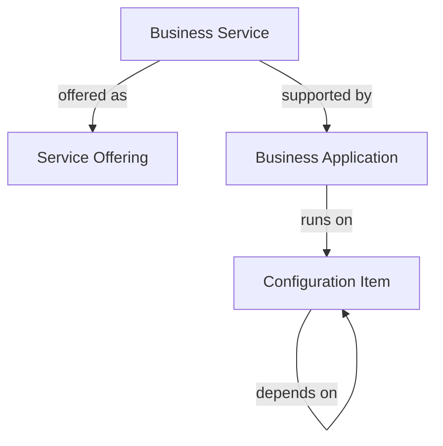

# CSDM-Inspired Service Model

**Phase:** 10 · ServiceNow's Common Service Data Model (CSDM), researched
for its architectural pattern, then simplified for our scope. Proprietary
CSDM implementation details (exact ServiceNow table names, CSDM version
2.0/4.0 taxonomy specifics) are **not** reproduced — we take the layering
principle, not the schema.

## CSDM's core idea

CSDM organizes technology and service data into **layers**, each answering
a different business question, connected by relationships rather than
collapsed into one flat CI table:

| Layer | Question it answers | Example |
|---|---|---|
| Business Capability | "What can the business do?" | "Process customer orders" |
| Business Application | "What software supports that?" | "Order Management System" |
| Business Service | "What service do consumers experience?" | "Email Service" |
| Service Offering | "What specific committed variant of that service?" | "Email — Standard" vs "Email — Premium" (different SLA) |
| Technology Service | "What underlying technical service delivers it?" | "Exchange Online tenant" |
| Application (technical) | "What deployed software instance?" | "Exchange Online — Prod" |
| Infrastructure / CI | "What actually runs it?" | VM, container, database instance |

**Why layered instead of one CI table with a "type" column:** a flat model
forces every question ("which business capability does this VM support?")
into a multi-hop, ambiguous traversal. CSDM's layering makes each level's
relationships explicit and directional, so impact analysis (an outage on a
VM → which Business Service → which Business Capability is affected) is a
short, well-typed graph walk instead of a guess.

## What we adapt vs. what we simplify

| CSDM concept | Our adaptation |
|---|---|
| Business Capability | **Deferred** — out of MVP scope; revisit only once Portfolio/Project work (out of scope) is built. Adding it prematurely would create a layer with no consumer. |
| Business Application | **Kept**, simplified: an Application represents a deployed software system, linked to the Business Service(s) it supports. |
| Business Service | **Kept** — the layer Incident/Change impact analysis actually needs ("what does the business call this?"). |
| Service Offering | **Kept** — this is what SLA Definitions attach to, not the raw Business Service, matching CSDM's own pattern (different offerings, different commitments). |
| Technology Service | **Merged into Application/CI relationship** for MVP — a separate Technology Service layer is real CSDM sophistication we don't yet have enough scale to justify; documented here as a `REQUIRES_VALIDATION` candidate for a later wave if impact-analysis quality demands finer granularity. |
| CI / Infrastructure | **Kept**, fully — this is `cmdb_ci`, elaborated in `cmdb-architecture.md` (Phase 11). |
| Relationship | **Kept as a generic typed graph edge table**, not per-layer bespoke FKs — same pattern established in `shared-enterprise-data-model.md`. |

## Our simplified layer graph

- `BusinessService` and `ServiceOffering`: owned in the CMDB context (they
  are service-model data, not tickets), referenced by SLA Definitions
  (Phase 49) and by Incident/Change for "affected service" fields.
- `Application`: a specific type of CI (`cmdb_ci` with `ci_class = 'Application'`)
  linked to a `BusinessService` via `cmdb_relationship(type = 'supports')`.
- Everything below `Application` (servers, containers, databases) is plain
  CI-to-CI relationship graph — see Phase 11.

## Why this matters for Incident/Change impact analysis

An agent viewing an Incident on a specific server needs to answer "what
Business Service is affected?" — with the layered model this is:
`CI → (depends-on graph, possibly multi-hop) → Application → (supports) →
Business Service → (offered-as) → Service Offering → (has) → SLA Definition`.
Each hop is a typed, indexed relationship — not a text-matching guess. This
is the concrete payoff for taking on CSDM's layering complexity instead of a
flat CI list.

## What we explicitly do not copy

- ServiceNow's exact CSDM table/field names and their version-specific
  taxonomy (2.0 vs. 4.0 differences) — proprietary implementation, not
  principle.
- Full CSDM foundation layer completeness (Business Capability, Product,
  Offering-as-commercial-SKU) — those solve enterprise portfolio-management
  problems out of scope for our MVP.

---

*Next: `docs/cmdb/cmdb-architecture.md` (Phase 11) — CI, relationships,
discovery, and data quality.*
