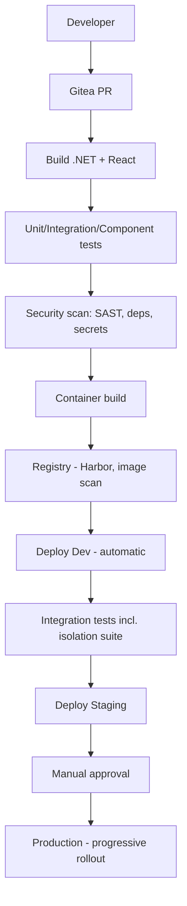
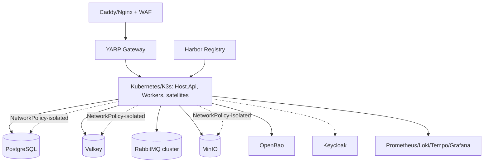
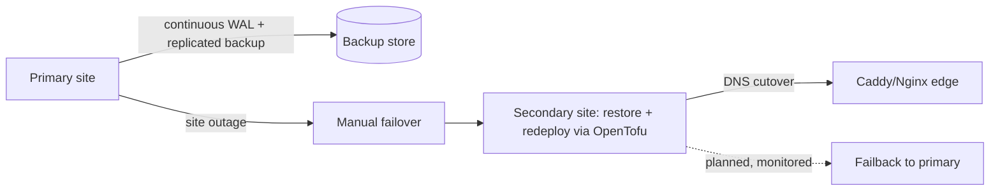
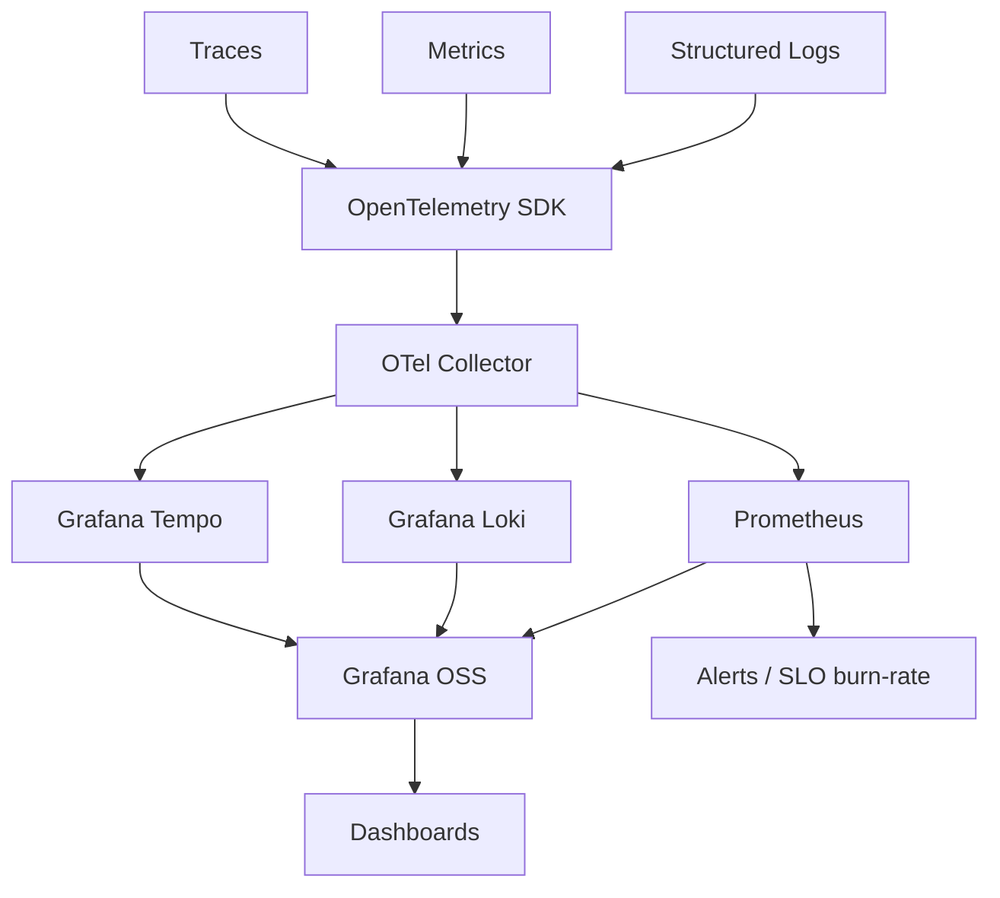

# Diagrams: CI/CD, Self-Hosted Production, Disaster Recovery, Observability

**Phase:** 42 · Diagrams 15–18. Infrastructure per
`docs/adr/ADR-022-oss-self-hosted-infrastructure-stack.md`.

## 15. CI/CD

Source: `docs/devops/cicd.md` (Phase 39).

## 16. Self-hosted production architecture

Source: `docs/infrastructure/self-hosted-production-architecture.md` (Phase 25).

## 17. Disaster recovery

Source: `docs/architecture/disaster-recovery.md` (Phase 26).

## 18. Observability

Source: `docs/observability/observability.md` (Phase 24).

---

*Next: `frontend-and-backend-architecture.md`.*
