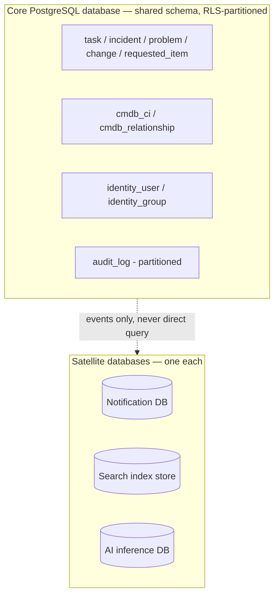
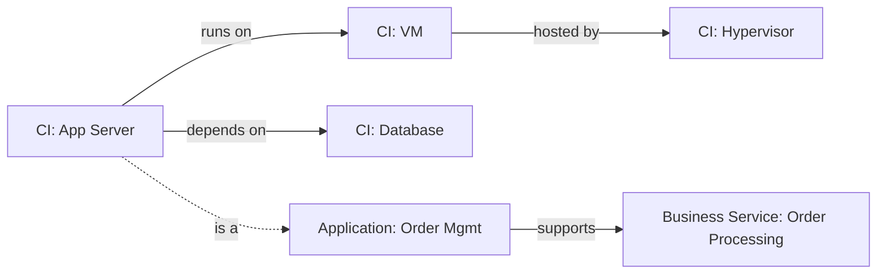
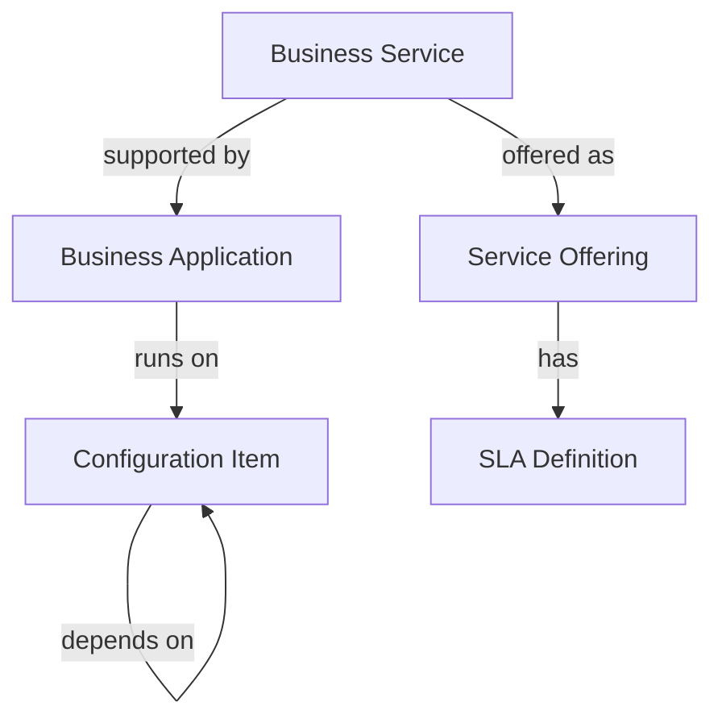

# Diagrams: Database & CMDB / CSDM Architecture

**Phase:** 42 · Diagrams 5, 13, 14.

## 5. Database architecture (hybrid topology)

Source: `docs/database/database-architecture.md` (Phase 7).

## 13. CMDB architecture (CI graph)

Source: `docs/cmdb/cmdb-architecture.md` (Phase 11).

## 14. CSDM-inspired architecture (service layering)

Source: `docs/cmdb/csdm-inspired-service-model.md` (Phase 10).

---

*Next: `security-and-auth-flows.md`.*
