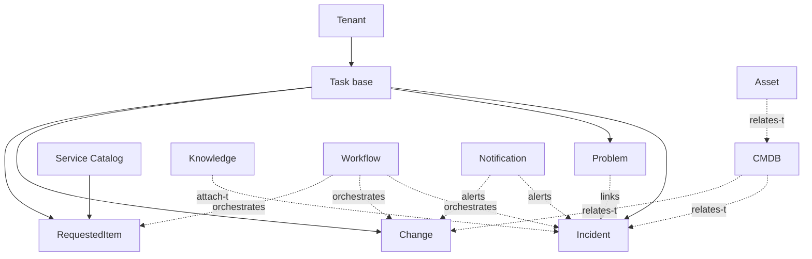
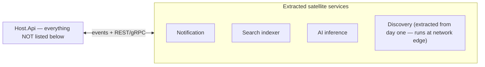

# Diagrams: Domain & Microservices Architecture

**Phase:** 42 · Diagrams 3–4.

## 3. Domain architecture (bounded contexts and their relationships)

Source: `docs/architecture/bounded-contexts.md` (Phase 5).

## 4. Microservices architecture (what's actually extracted)

Source: `docs/architecture/microservice-boundary-rules.md` (Phase 6)
decision matrix.

---

*Next: `database-and-cmdb-architecture.md`.*
