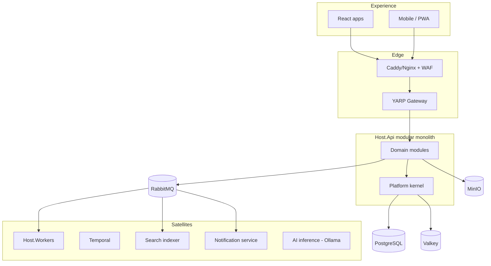
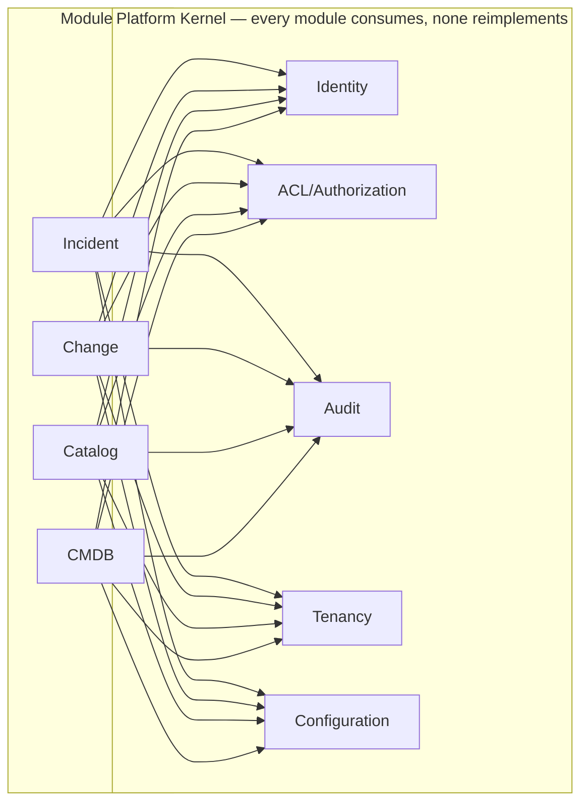

# Diagrams: Enterprise & Platform Architecture

**Phase:** 42 · Diagrams 1–2 of the required set. Reproduces/centralizes
diagrams that also live inline in their source phase documents (linked per
diagram) so this directory is a complete visual index.

## 1. Enterprise architecture

Source: `docs/architecture/target-enterprise-architecture.md` (Phase 4).

## 2. Platform architecture (kernel capabilities)

Source: `docs/architecture/target-enterprise-architecture.md` §Unified capabilities (Phase 4).

---

*Next: `domain-and-microservices-architecture.md`.*
