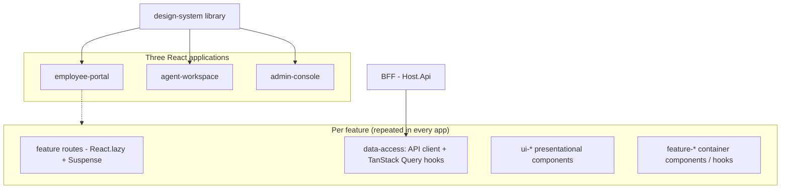
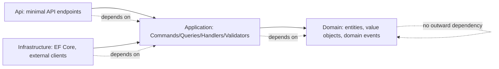

# Diagrams: React & .NET Architecture

**Phase:** 42 · Diagrams 19–20 (completes the required diagram set).
Frontend framework per `docs/adr/ADR-021-react-over-angular.md`.

## 19. React architecture

Source: `docs/frontend/react-architecture.md` (Phase 30).

## 20. .NET architecture (per-module Clean Architecture)

Source: `docs/backend/dotnet-architecture.md` (Phase 31).

---

*This completes the required 20-diagram set (Phase 42). Index of all
diagram files:*

| # | Diagram | File |
|---|---|---|
| 1–2 | Enterprise, Platform | `enterprise-and-platform-architecture.md` |
| 3–4 | Domain, Microservices | `domain-and-microservices-architecture.md` |
| 5, 13, 14 | Database, CMDB, CSDM | `database-and-cmdb-architecture.md` |
| 6–7 | AuthN, AuthZ | `security-and-auth-flows.md` |
| 8–12 | Request, Event, Workflow, Audit, Notification | `lifecycle-flows.md` |
| 15–18 | CI/CD, Self-Hosted Infra, DR, Observability | `cicd-and-infrastructure.md` |
| 19–20 | React, .NET | this file |

*Next: `docs/roadmap/implementation-roadmap.md` (Phase 43).*
