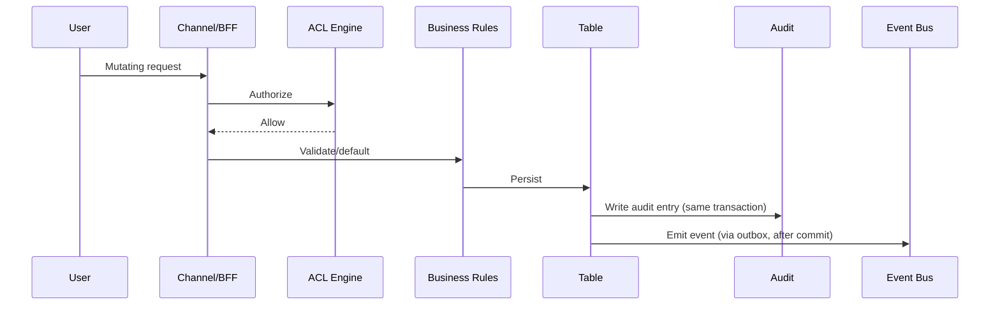
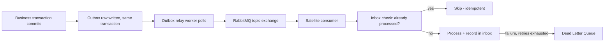
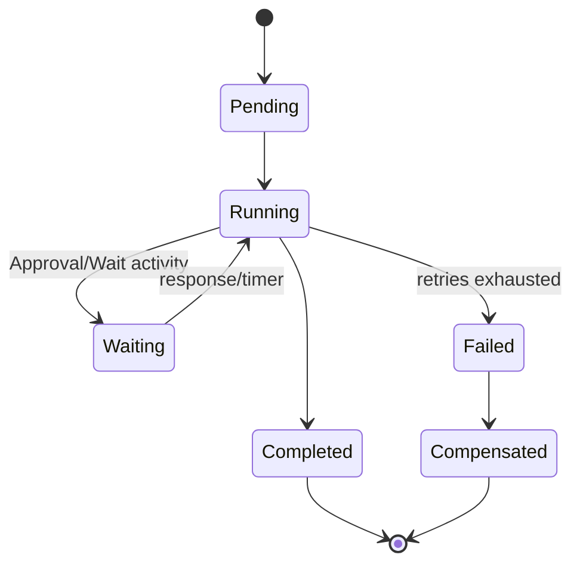
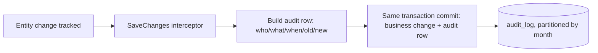
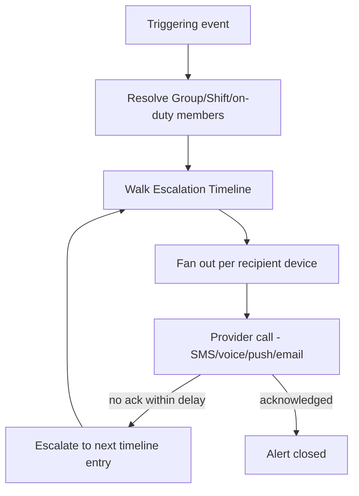

# Diagrams: Request, Event, Workflow, Audit, Notification Lifecycles

**Phase:** 42 · Diagrams 8–12.

## 8. Request lifecycle (a single API call, full path)

Source: `docs/architecture/servicenow-layered-architecture.md` (Phase 3),
applied to our stack in `docs/api/api-design-rules.md` (Phase 16).

## 9. Event lifecycle (outbox → RabbitMQ → satellite)

Source: `docs/integration/event-driven-architecture.md` (Phase 14).

## 10. Workflow execution

Source: `docs/workflow/workflow-engine-architecture.md` (Phase 12).

## 11. Audit flow

Source: `docs/audit/audit-architecture.md` (Phase 19).

## 12. Notification flow

Source: `docs/architecture/09-notification-oncall-escalation-engine.md` §3,
`docs/platform/notification-service.md` (Phase 20).

---

*Next: `cicd-and-infrastructure.md`.*
