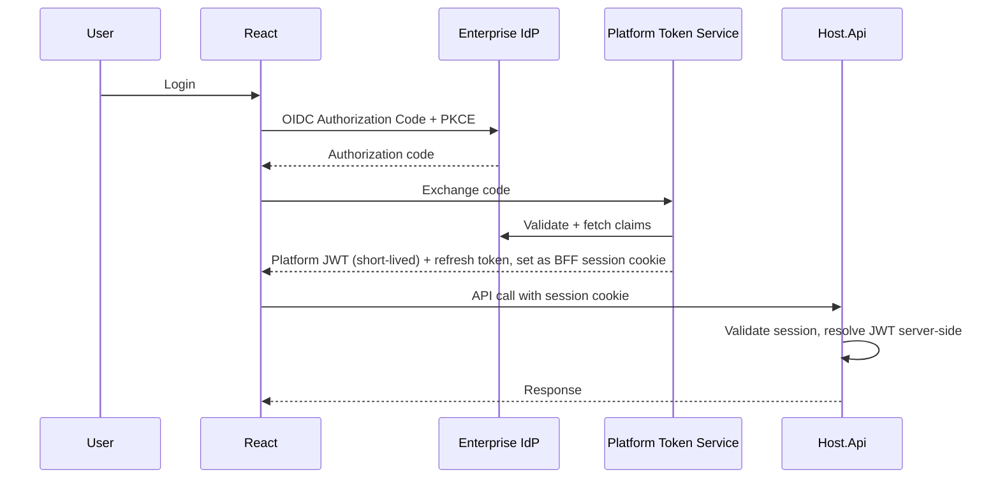
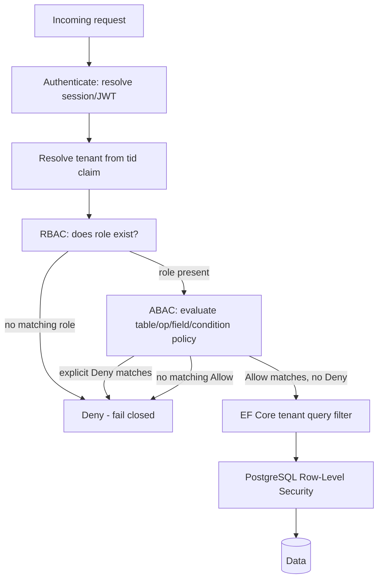

# Diagrams: Authentication & Authorization Flow

**Phase:** 42 · Diagrams 6–7.

## 6. Authentication flow

Source: `docs/security/security-architecture.md` (Phase 17).

## 7. Authorization flow

Source: `docs/security/security-architecture.md` §Authorization (Phase 17).

---

*Next: `lifecycle-flows.md`.*
