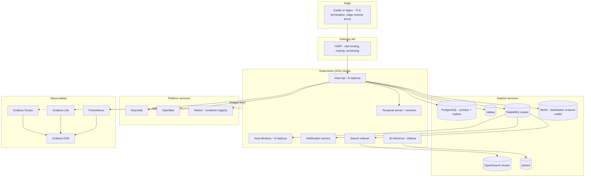

# Self-Hosted Production Architecture

**Phase:** 25 (revised) · Primary deployment reference, superseding
`docs/azure/production-architecture.md` per
`docs/adr/ADR-022-oss-self-hosted-infrastructure-stack.md`. Every
component below is justified individually, matching the discipline the
original Azure document established — "do not assume every service is
necessary" now applies to self-hosted components too, not just managed
cloud ones.

## Topology

## Component-by-component justification

| Component | Why | When | Operational cost | Alternative | Security | Scalability |
|---|---|---|---|---|---|---|
| **Caddy or Nginx** | TLS termination, edge reverse proxy; Caddy's automatic HTTPS (ACME) lowers cert-management burden versus Nginx+certbot | Day one, public-facing | Low–moderate — one more service to run, but simple config | Terminate TLS at YARP directly — rejected: mixes edge concerns (cert rotation, HTTP/2, connection handling at internet scale) with application-tier routing logic | First line of defense; pairs with a WAF module if the threat model requires it (not assumed included by default) | Horizontally scalable behind a load balancer/DNS round-robin |
| **YARP** | .NET-native reverse proxy: per-tenant rate limiting, routing, API versioning at the application tier, extensible in the same language as the rest of the platform | Day one | Low — runs as part of/alongside `Host.Api`'s deployment | Azure API Management (rejected, managed dependency) or hand-rolled middleware (rejected — reinvents a solved problem) | Re-validates JWT/ACL is still `Host.Api`'s job (defense in depth, `security-architecture.md`) — YARP is not trusted as the sole gate | Scales with `Host.Api` replicas |
| **Kubernetes (K3s)** | Orchestrates `Host.Api`, `Host.Workers`, satellites, and stateful services uniformly; K3s specifically lowers control-plane resource overhead versus full upstream Kubernetes for small-to-mid clusters | Day one for production | **Highest operational item in this stack** — the team operates cluster upgrades, node lifecycle, networking (CNI), and storage (CSI) directly | Docker Compose in production (rejected — no self-healing, no rolling deploys, no horizontal scaling primitives at that scale); full upstream Kubernetes/managed K8s (viable alternative if K3s's trimmed feature set becomes limiting) | Namespace-per-environment isolation, NetworkPolicies restricting pod-to-pod traffic, RBAC scoped per service | Native horizontal pod autoscaling per deployable |
| **PostgreSQL (self-managed, e.g. via the CloudNativePG or Zalando operator)** | Matches the locked database decision; an operator gives Kubernetes-native HA/backup/failover instead of hand-rolled scripts | Day one | Moderate — operator reduces but does not eliminate DB operations expertise needed | A managed Postgres service on a specific cloud — rejected, reintroduces vendor dependency `ADR-022` removes | Network-policy-restricted, TLS between app and DB, RLS per `multi-tenancy.md` | Read replicas for reporting/search-lag offload |
| **Valkey** | Session/lock/rate-limit/config cache, per `ADR-017` | Day one | Low — simple to run in HA mode (Sentinel or cluster mode) on K8s | — (already the decision) | Network-policy-restricted; never a system of record (`ADR-017`) | Clustered mode if hot-key/throughput demands it |
| **RabbitMQ cluster** | Matches `ADR-004`/`ADR-016`; clustering gives HA for the outbox/inbox event backbone | Day one | **Second-highest operational item** — clustering, quorum queues, and upgrade coordination are real ongoing work, as already flagged in `ADR-004` | Azure Service Bus (rejected, managed dependency, contradicts `ADR-022`) | TLS + per-service credentials, vhost-per-environment isolation | Quorum queues scale with cluster size |
| **MinIO (distributed mode)** | Object storage, per `ADR-019` amendment; distributed mode with erasure coding replaces Blob Storage's managed geo-redundancy | Day one | Moderate — requires enough nodes/disks for the chosen erasure-coding scheme to tolerate real node loss | Azure Blob Storage (rejected, managed dependency) | Bucket policies, tenant-prefixed buckets, SSE via OpenBao | Scales by adding nodes to the distributed set |
| **OpenSearch cluster** | Search backend, per `ADR-014` amendment | Day one (promoted from "later") | Moderate — JVM-based, needs real memory/heap sizing and index-lifecycle management | PostgreSQL FTS only (viable minimal-footprint fallback, documented in `search-architecture.md`) | Security plugin (index-level access control) layered under the application's own ACL pre-filtering (`search-architecture.md`) | Sharding/replica configuration scales with data volume |
| **Qdrant** | Vector DB for RAG embeddings (Phase 46/47), superseding the deferred `pgvector` evaluation | When AI/RAG features ship (Phase 11 of the roadmap) | Low–moderate, scoped to when AI features are active | `pgvector` on the existing PostgreSQL instance (still a viable lighter-weight option for a deployment that wants to avoid a new stateful service) | Collection-level access scoping aligned to tenant/ACL filtering (`ai-governance.md`) | Scales independently of the core database |
| **Keycloak** | Self-hosted IdP; enterprise tenants can still broker their own Entra ID/Okta/SAML IdP through it | Day one | Moderate — its own database (can share the PostgreSQL cluster with a dedicated schema/database) and session state | A managed IdP (rejected, contradicts `ADR-022`) | MFA, brute-force detection, and session management configured centrally | Clustered Keycloak for HA |
| **OpenBao** | Secrets/key management, per security architecture | Day one | Moderate — unseal/root-token ceremony, storage backend (e.g. its own PostgreSQL/Raft storage) operated carefully | Azure Key Vault (rejected) | The single highest-sensitivity component in the stack — access tightly scoped via AppRole/K8s auth, audited | Raft-based HA storage backend |
| **Harbor** | Container registry with built-in vulnerability scanning (Trivy) and image signing support | Day one | Low–moderate | Azure Container Registry (rejected); a public registry (rejected — no private-by-default posture for a proprietary codebase) | Image scanning gates promotion past `dev`, matching the original CI/CD scan requirement | Scales with storage backend (can itself use MinIO) |
| **Prometheus / Loki / Tempo / Grafana** | Observability backend, per `ADR-018` amendment | Day one | Moderate — retention/storage sizing for metrics/logs/traces at scale is an ongoing tuning task | Azure Monitor (rejected) | Grafana access control per team/role | Prometheus federation or remote-write to a longer-term store (e.g. Thanos/Mimir) if retention needs grow beyond single-instance Prometheus |

## Deployment environments

| Environment | Topology |
|---|---|
| **Local dev** | `deploy/docker-compose.yml` — PostgreSQL, Valkey, RabbitMQ, MinIO, OpenSearch (optional, can fall back to PostgreSQL FTS locally), Keycloak, OpenBao (dev mode), Mailpit (local SMTP capture), Temporal (dev server) |
| **CI** | Testcontainers spin up the same images ad hoc per test run (`docs/testing/testing-strategy.md`) |
| **Staging/Production** | Kubernetes (K3s), per the topology diagram above, provisioned via OpenTofu |

## What we deliberately do NOT provision by default

- **A managed WAF-as-a-service** — a self-hostable WAF module (e.g.
  ModSecurity on Nginx) is evaluated as a follow-up only if the threat
  model requires it beyond Caddy/Nginx + YARP + application-layer defenses.
- **Full upstream Kubernetes** in place of K3s — until K3s's trimmed
  feature set is proven insufficient (mirrors the original ACA-vs-AKS
  "start simpler, name the fallback" discipline, now one layer down the
  stack).
- **A second geographic region as active-active** — DR posture (see
  `docs/architecture/disaster-recovery.md`, which needs a companion
  self-hosted DR runbook: PostgreSQL streaming replication to a
  secondary site, MinIO bucket replication, RabbitMQ federation) is
  decided by actual RTO/RPO requirements, not provisioned speculatively.

## Relationship to the Azure document

`docs/azure/production-architecture.md` is retained as a **documented
alternative deployment target**, not deleted — a tenant/environment that
specifically wants Azure-managed services remains supportable precisely
because this program's provider abstractions (`IModelProvider`,
`INotificationProvider`, `ISearchProvider`) don't hard-code MinIO/OpenSearch/
Ollama into application code. It is simply no longer the default.

---

*Next: `docs/architecture/disaster-recovery.md` (Phase 26) — needs a
companion self-hosted DR runbook per the note above.*
