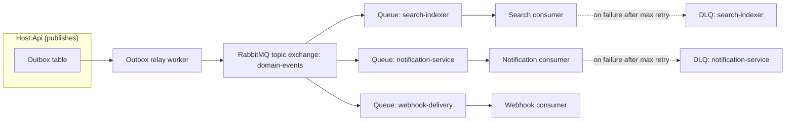

# Event-Driven Architecture (RabbitMQ)

**Phase:** 14 · How domain state changes propagate across module and
service boundaries reliably.

## Vocabulary — commands vs. events

| Concept | Definition | Example | Who decides |
|---|---|---|---|
| **Command** | An instruction to do something, addressed to exactly one handler, expected to succeed or fail | `ResolveIncident`, `SendNotification` | The sender knows what should happen |
| **Domain event** | A fact that already happened inside a bounded context, published for any number of subscribers | `IncidentResolved`, `CIRelationshipChanged` | The publisher does not know or care who's listening |
| **Integration event** | A domain event's public, versioned, cross-boundary contract shape — deliberately decoupled from the internal domain event's shape so internal refactors don't break subscribers | `IncidentResolvedIntegrationEvent { IncidentId, TenantId, ResolvedAt }` | Published by the owning context, consumed by satellites (Search, Notification) and external webhooks |

**Rule:** commands go to RabbitMQ **work queues** (competing consumers, one
handler); events go to **topic exchanges** (fan-out to any number of
subscribers). Conflating the two — publishing a "please do X" as a broadcast
event, or sending a "this happened" fact to only one queue — is a named
anti-pattern (`docs/rules/anti-patterns.md`).

## Topology

## Outbox pattern (publish side)

- A domain write and its corresponding event **commit in the same
  PostgreSQL transaction**, written to an `outbox` table (`id`,
  `event_type`, `payload`, `tenant_id`, `correlation_id`, `causation_id`,
  `created_at`, `published_at`).
- A separate relay worker polls unpublished rows and publishes to RabbitMQ,
  marking `published_at` on confirmed publish (RabbitMQ publisher confirms).
- **This is what prevents the classic "DB write succeeded, event publish
  failed, downstream never finds out" bug** — the event's existence is
  guaranteed the instant the business transaction commits, independent of
  RabbitMQ's availability at that exact moment.

## Inbox pattern (consume side)

- Every consumer records the `event_id` (or command's idempotency key) it
  has processed in an `inbox` table **before** acting on side effects it
  cannot itself make idempotent (e.g. calling an external SMS provider).
- On redelivery (RabbitMQ at-least-once delivery, consumer crash/retry,
  network blip), the consumer checks the inbox first and skips reprocessing
  if already recorded — this is the concrete mechanism behind Master AI
  Command Rule 11 ("every event consumer must be idempotent").

## Retry and dead-letter queue

- Consumer-level retry: bounded attempts with exponential backoff
  (RabbitMQ delayed-exchange or a scheduled redelivery), **never unlimited
  retries** (Master AI Command anti-pattern list).
- After max attempts, the message routes to a **per-queue DLQ**, not a
  single shared DLQ — so a poison message in Notification delivery doesn't
  obscure a genuinely different failure in Search indexing.
- DLQ messages are alerted on (see `docs/observability/observability.md`)
  and require manual triage — auto-requeue-forever from a DLQ is explicitly
  disallowed (it just recreates the unlimited-retry anti-pattern one hop
  later).

## Ordering

- RabbitMQ does not guarantee global ordering across a fanned-out topic
  exchange. Where order matters within one entity's event stream (e.g. a
  Task's state transitions must be applied in sequence by the Search
  indexer), events carry a **monotonic per-entity sequence number**, and
  consumers that care about order buffer/reorder using it rather than
  assuming delivery order.
- Where order does not matter (most integration events), no ordering
  guarantee is required or engineered for — added complexity only where the
  business logic actually needs it.

## Correlation ID and causation ID

- **Correlation ID**: generated once at the origin of a user action or
  external trigger, propagated through every command, event, and workflow
  step that action causes — used to trace one logical operation across
  process/service boundaries (ties into OpenTelemetry trace context, Phase
  24).
- **Causation ID**: the ID of the specific message that directly caused this
  one (a chain, not a single shared value) — lets you reconstruct "B
  happened because of A, which happened because of the original user
  request," useful for debugging cascades that a flat correlation ID alone
  can't distinguish (e.g. two different events sharing one correlation ID
  but with different immediate causes).

## What publishes/subscribes to what (representative)

| Publisher | Event | Consumers |
|---|---|---|
| Task/Incident context | `IncidentResolved` | Search indexer, SLA Engine (stop clock), Notification (CSAT survey trigger) |
| CMDB context | `CIRelationshipChanged` | Search indexer, Change risk assessment (cache invalidation) |
| Workflow engine | `WorkflowInstanceCompleted` | Originating domain (apply outcome), Audit |
| Notification service | `AlertAcknowledged` | Task engine (auto-assign), Audit |
| Identity | `UserRoleChanged` | ACL cache invalidation (all modules), Audit |

---

*Next: `docs/api/rest-grpc-rules.md` (Phase 15).*
