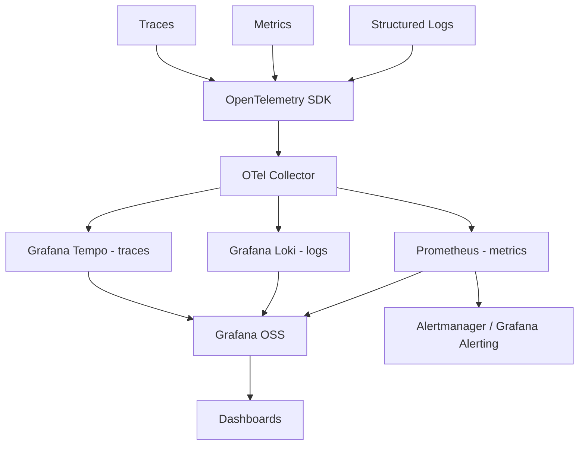

# Observability

**Phase:** 24 · OpenTelemetry → Prometheus / Grafana Loki / Grafana Tempo /
Grafana OSS, per `docs/adr/ADR-022-oss-self-hosted-infrastructure-stack.md`
(`ADR-018` amendment) — self-hosted, replacing Azure Monitor / Application
Insights. The OpenTelemetry instrumentation layer itself (below) is
unchanged; only the export backend differs.

## The three pillars, plus correlation

- **Traces**: every request generates a root span at the gateway/BFF; every
  downstream call (EF Core query, RabbitMQ publish/consume, gRPC call,
  external HTTP call) is a child span, propagating W3C Trace Context
  (`traceparent` header) automatically via OpenTelemetry's ASP.NET Core and
  HttpClient instrumentation.
- **Trace ID / Span ID**: standard OTel identifiers; the platform's own
  `X-Correlation-Id` (business-facing, used in support tickets and audit
  logs) is set as a **span attribute**, linking the human-facing
  correlation ID to the underlying distributed trace for debugging.
- **Metrics**: RED metrics (Rate, Errors, Duration) per endpoint by
  default via ASP.NET Core instrumentation, plus domain-specific counters
  (SLA breaches/hour, workflow instances failed, notification delivery
  latency) emitted explicitly from the relevant module.
- **Structured logging**: JSON structured logs (`ILogger` with
  structured message templates, never string-concatenated messages),
  every log line carrying `TraceId`, `TenantId`, and `CorrelationId` as
  scoped properties automatically.

## Health checks

- `/healthz/live` — process is up (no dependency checks; used for
  container orchestrator restart decisions).
- `/healthz/ready` — dependency checks (PostgreSQL, Valkey, RabbitMQ
  reachable) — used to gate traffic admission at the load balancer/gateway,
  not to trigger a restart.
- Every satellite service exposes the same two endpoints independently.

## Dashboards and alerts (minimum set from day one)

| Dashboard | Key panels |
|---|---|
| API health | Request rate, error rate, p50/p95/p99 latency per endpoint |
| Tenant isolation canary | Automated isolation test result trend (see `docs/testing/testing-strategy.md`) |
| Workflow/SLA | Instances started/completed/failed, SLA breach rate |
| Notification delivery | Delivery latency per channel, ack rate, DLQ depth |
| RabbitMQ | Queue depth, consumer lag, DLQ message count per queue |
| PostgreSQL | Connection pool saturation, slow query log, replication lag (read replicas) |
| Security | Auth failure rate, 403 spike detection, impersonation events outside business hours |

## SLO / SLA discipline

- Every platform capability with a user-facing latency/availability
  expectation gets a **documented SLO** (e.g. "95% of Table API reads
  complete under 300ms," "99.9% Notification delivery within 30s for P1
  alerts") before it's called production-ready — not retrofitted after an
  incident.
- SLOs feed error-budget-based alerting (burn-rate alerts), not naive
  static thresholds alone, once sufficient baseline data exists.

## What must never ship without observability

Per Master AI Command Rule 14: every production component has monitoring
and health checks **before** it is considered done — this is enforced as
part of the Definition of Done (`docs/governance/definition-of-done.md`,
Phase 54), not left as a best-effort follow-up.

---

*Next: `docs/infrastructure/self-hosted-production-architecture.md` (Phase 25).*
