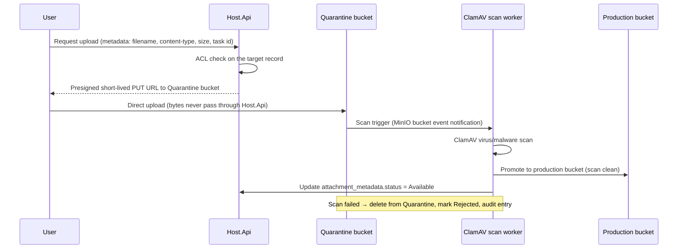

# File / Attachment Architecture

**Phase:** 23 · **MinIO** (S3-compatible, self-hosted), per
`docs/adr/ADR-022-oss-self-hosted-infrastructure-stack.md` /
`ADR-019-blob-storage.md`. Antivirus: **ClamAV**.

## Upload path



- **Direct-to-bucket upload** via a short-lived presigned PUT URL (MinIO's
  S3-API-compatible presigned URLs) — large files never transit
  `Host.Api`'s request pipeline.
- **Quarantine-then-promote**: nothing is retrievable by any user until it
  clears **ClamAV** scanning — matches the security document's attachment
  rule (content-type sniffing, not filename trust, plus scan before serve).
  MinIO's bucket event notifications (webhook or AMQP — routed via
  RabbitMQ, already in the stack) trigger the scan worker on object
  creation, rather than a custom polling job.

## Metadata

```sql
CREATE TABLE attachment_metadata (
    id UUID PRIMARY KEY,
    tenant_id UUID NOT NULL,
    task_id UUID NOT NULL,
    bucket TEXT NOT NULL,
    object_key TEXT NOT NULL,        -- tenant-prefixed
    content_type TEXT NOT NULL,
    size_bytes BIGINT NOT NULL,
    status TEXT NOT NULL,             -- Quarantined, Available, Rejected
    uploaded_by UUID NOT NULL,
    created_at TIMESTAMPTZ NOT NULL DEFAULT now()
);
```

## Access control

- **Download** requires the same ACL check as reading the parent record,
  re-evaluated on every download request (not cached from upload time) —
  matches the security document's rule that attachment access is
  re-checked, not grant-once.
- Download is served via a **short-lived presigned GET URL**, generated
  after the ACL check passes — `Host.Api` never proxies large file bytes.

## Retention and lifecycle

- **Retention policy** is tenant-configurable (default aligned with the
  tenant's data governance policy, `docs/governance/data-governance.md`),
  enforced via **MinIO Object Lifecycle Management** (auto-transition to a
  colder storage class if configured, auto-delete past retention) rather
  than a custom scheduled job re-implementing what the platform already
  provides.
- **Legal hold** — implemented via MinIO's **Object Locking** (WORM mode)
  or an application-level exclusion from the lifecycle policy — a flagged
  record's attachments are excluded from lifecycle deletion regardless of
  age.

## Encryption

- MinIO server-side encryption at rest, tenant-prefixed buckets (SSE-KMS
  backed by OpenBao's transit secrets engine for enterprise tier,
  `docs/security/security-architecture.md`).
- TLS in transit for all upload/download URLs.

## Deployment note

- Local/dev: MinIO runs as a `deploy/docker-compose.yml` service.
- Production: MinIO runs as a stateful workload on Kubernetes/K3s
  (distributed mode with erasure coding for durability, replacing Blob
  Storage's managed geo-redundancy — see
  `docs/infrastructure/self-hosted-production-architecture.md` for the
  durability/DR trade-off this implies).

---

*Next: `docs/observability/observability.md` (Phase 24).*
