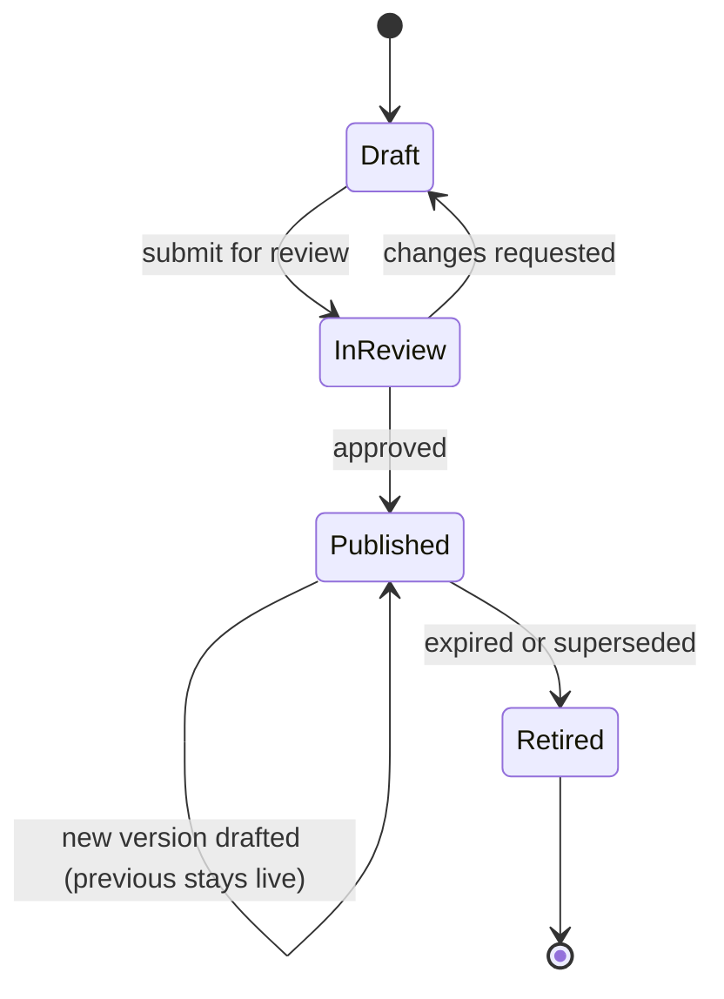

# Knowledge Management

**Phase:** 22 · A platform capability (per Phase 1 finding: Knowledge is
consumed by every customer-facing product, not owned by ITSM alone).

## Lifecycle



## Data model

```sql
CREATE TABLE knowledge_article (
    id UUID PRIMARY KEY,
    tenant_id UUID NOT NULL,
    category_id UUID NOT NULL,
    current_version_id UUID,
    status TEXT NOT NULL,          -- Draft, InReview, Published, Retired
    visibility TEXT NOT NULL,      -- Internal, CustomerFacing, RoleRestricted
    expires_at TIMESTAMPTZ,
    created_at TIMESTAMPTZ NOT NULL DEFAULT now()
);

CREATE TABLE knowledge_article_version (
    id UUID PRIMARY KEY,
    article_id UUID NOT NULL REFERENCES knowledge_article(id),
    version_number INT NOT NULL,
    title TEXT NOT NULL,
    body TEXT NOT NULL,
    author_id UUID NOT NULL,
    created_at TIMESTAMPTZ NOT NULL DEFAULT now()
);

CREATE TABLE knowledge_feedback (
    id UUID PRIMARY KEY,
    article_id UUID NOT NULL,
    user_id UUID,
    helpful BOOLEAN,
    comment TEXT,
    created_at TIMESTAMPTZ NOT NULL DEFAULT now()
);
```

- **Versioning:** every publish creates a new immutable
  `knowledge_article_version` row; `current_version_id` points at the live
  one. Prior versions remain queryable (audit/rollback), never overwritten
  in place.
- **Categories:** hierarchical, tenant-defined metadata — drives portal
  navigation and ACL scoping (some categories may be role-restricted, e.g.
  internal-only runbooks vs. customer-facing articles).
- **Approval:** publishing a new version routes through the standard
  Workflow `Approval` activity (Phase 12) — Knowledge does not implement its
  own approval mechanism.
- **Expiry:** `expires_at` triggers a scheduled job (`Host.Workers`) that
  flags the article for review rather than silently unpublishing it —
  stale-but-still-published is worse than flagged-for-review in most
  ITSM contexts.
- **Feedback:** lightweight helpful/not-helpful + comment, aggregated into
  the article's quality score, surfaced to authors — feeds the "which
  articles need attention" backlog.

## Search and permissions

- Indexed by the Search platform (Phase 21) with `visibility` and
  `category_id` as filter facets for security trimming.
- Field-level ACL applies to `RoleRestricted` articles exactly like any
  other tenant data — Knowledge does not get a separate authorization
  mechanism.

## Consumers

- **Employee/Customer portal search** (self-service deflection).
- **Agent Workspace** contextual panel (suggested articles based on
  Incident category/CI).
- **AI grounding source** for RAG-based assist (Phase 46/47) — **only**
  `Published`, tenant-scoped, ACL-visible-to-the-requesting-user articles
  are eligible content; `Draft`/`InReview` content is never used as
  grounding context.

---

*Next: `docs/platform/file-storage.md` (Phase 23).*
