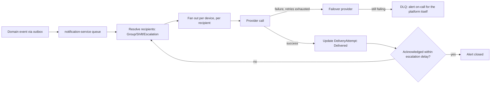

# Notification Platform

**Phase:** 20 · Extends/supersedes stack specifics in
`docs/architecture/09-notification-oncall-escalation-engine.md` per
`ADR-000`; the domain model (Group/Shift/Rotation/Escalation Timeline,
xMatters-derived escalation rules) is stack-agnostic and fully carried
forward unchanged — this document adds the concrete PostgreSQL/RabbitMQ/
self-hosted implementation (per `docs/adr/ADR-022-oss-self-hosted-infrastructure-stack.md`)
and covers the Master AI Command's specific channel and delivery
requirements.

## Channels

| Channel | Provider abstraction | Notes |
|---|---|---|
| Email | `IEmailProvider` (e.g. self-hosted Postfix/SMTP relay in production, **Mailpit** for local dev message capture, or a third-party API like SendGrid) | Templated, localized |
| SMS | `ISmsProvider` (e.g. Twilio or another SMS gateway — no self-hostable equivalent exists for carrier SMS delivery, so this one channel keeps an external provider dependency regardless of the OSS stack direction) | Closed-loop reply supported where provider allows |
| Push | `IPushProvider` (mobile app, APNs/FCM via a unified abstraction) | Closed-loop accept/decline |
| In-app | Direct write to a `notification_inbox` table + React real-time update (SignalR-equivalent over WebSocket, or polling fallback) | No external provider dependency — always available even if all external channels are down |
| Webhook | Outbound HTTP via the Integration fabric's outbox-backed delivery worker | For Teams/Slack/other systems |
| Teams / Slack | Built on the webhook mechanism + an incoming-webhook or bot-framework integration per platform | Optional per tenant configuration |

## Provider abstraction (why)

```csharp
public interface INotificationProvider
{
    ChannelType Channel { get; }
    Task<DeliveryResult> SendAsync(NotificationMessage message, CancellationToken ct);
}
```

Every channel has **at least one fallback provider** configured for
production tenants above a size threshold; the delivery worker fails over
automatically on provider error/timeout (per the reliability requirements
already established in the earlier notification document §7) — this is a
carried-forward requirement, not new.

## Templates, preferences, localization

- **Templates**: versioned, tenant-editable (Admin console), support
  variable substitution from the triggering record's context — stored as
  metadata rows, not compiled code, matching the platform's
  metadata-over-hardcoded principle.
- **Preferences**: per-user channel ordering and quiet-hours configuration,
  overridable by message priority (a P1 major incident page can override a
  user's "no SMS after 9pm" preference — configurable per tenant policy).
- **Localization**: templates support locale variants; recipient's
  `PreferredLocale` (from their Identity profile) selects the variant at
  send time, falling back to a tenant default.

## Delivery pipeline (RabbitMQ)



- Retries, dead-lettering, and idempotency follow
  `docs/integration/event-driven-architecture.md` exactly — this service is
  a RabbitMQ consumer/publisher like any other satellite, not a special
  case.
- **Rate limits**: per-tenant and per-provider send-rate caps to avoid one
  tenant's alert storm exhausting a shared provider quota that would affect
  other tenants — enforced in the delivery worker, backed by Valkey counters.

## Dead letter handling specific to notifications

A notification that exhausts all providers and retries is not just logged —
it triggers the **end-of-sequence fallback** already defined in the
escalation rules (`09-notification-oncall-escalation-engine.md` §3.5), and
additionally raises an internal platform alert (self-monitoring: "the
alerting system itself failed to reach someone" is treated as a severity-1
platform incident).

## Data model delta vs. the earlier document

Unchanged (Group, Shift, EscalationTimeline, Device, Alert, AlertRecipient,
DeliveryAttempt, CommunicationPlan) — see the earlier document §8 for the
full schema sketch, now implemented as its **own dedicated PostgreSQL
database** per the Phase 6/7 extraction decision (Notification is a
satellite service from day one).

---

*Next: `docs/platform/search-architecture.md` (Phase 21).*
