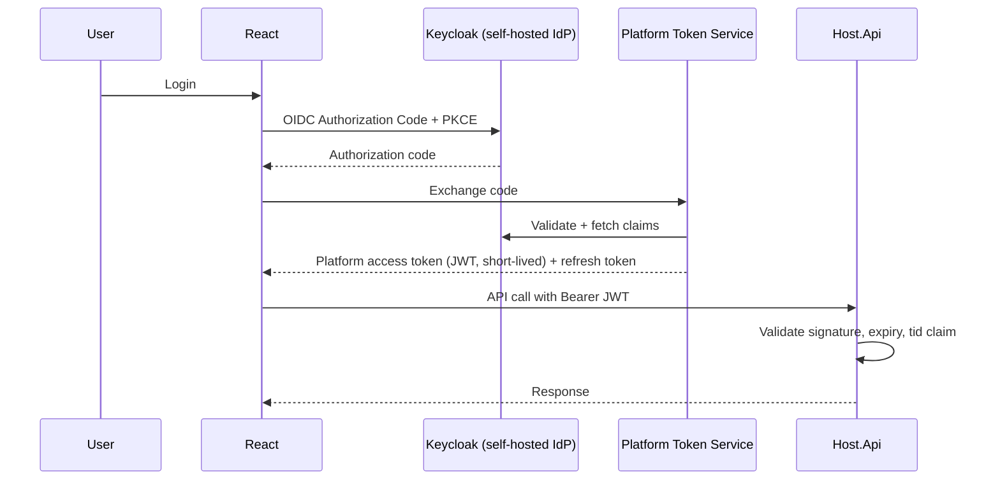
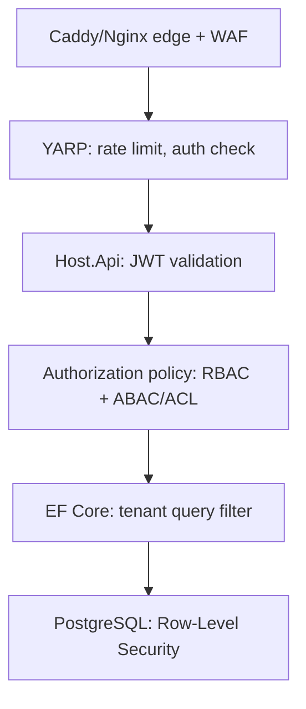

# Security Architecture (Zero Trust)

**Phase:** 17 · Supersedes `docs/architecture/01-security-architecture.md`
per `ADR-000` for stack specifics (PostgreSQL RLS, OAuth2/OIDC+JWT); the
threat model and zero-trust principles from that earlier document remain
valid and are carried forward, restated here against the current stack.
Secrets/identity products updated per `docs/adr/ADR-022-oss-self-hosted-infrastructure-stack.md`:
**OpenBao** for secrets (was Key Vault), **Keycloak** as the self-hosted
IdP (was direct Entra ID/Okta federation only).

## Zero Trust principles (unchanged from earlier work, restated)

1. Every request is authenticated and authorized at the data-access
   boundary — no layer is implicitly trusted (see
   `docs/architecture/servicenow-layered-architecture.md` for why the
   enforcement point is the table, not the caller).
2. Fail closed: missing tenant context, missing role, or an ACL evaluation
   error all deny access.
3. Defense in depth: application ACL is backed by PostgreSQL Row-Level
   Security, not trusted alone.
4. Least privilege by default; every capability is an explicit grant.
5. Every mutation, permission change, and impersonation is audited,
   immutably.

## Identity: OAuth2 / OIDC + JWT



- **Authorization Code + PKCE** flow for the React SPA — no implicit flow,
  no tokens in URL fragments logged by proxies.
- **Access tokens**: JWT, short-lived (10–15 min), signed by the platform
  token service after federating with the enterprise IdP — the IdP's own
  token is exchanged, never forwarded to downstream APIs directly.
- **Refresh tokens**: rotated on use, bound to a revocable session record
  (Valkey-backed for fast revocation checks).
- **Service identities**: OAuth2 client-credentials grant for
  service-to-service and integration/API-key callers; internal gRPC calls
  between core and satellite services additionally use **mTLS** for
  transport-level mutual authentication (defense in depth beyond the JWT).
- Claims: `sub`, `tid` (tenant), `roles` (informational for UI only — never
  trusted for the actual authorization decision, which is always
  re-resolved server-side against current DB state).

## Authorization: RBAC + ABAC (policy-based)

- **RBAC** (Roles) grants coarse capability (`itil_agent`, `cmdb_admin`,
  `security_admin`).
- **ABAC/policy-based** narrows it: a .NET **authorization policy** per
  table/operation/field, evaluated server-side, mirroring the
  table+operation+field+condition ACL model from the earlier security
  document — implemented as ASP.NET Core `IAuthorizationHandler` policies
  backed by metadata-defined rules (not hardcoded per-controller
  `[Authorize]` attributes only — those check role presence, the policy
  handler checks the full condition).
- **Tenant isolation** as the outermost, always-applied policy layer —
  evaluated before any table/field policy.
- Rule evaluation order and fail-closed behavior are unchanged from the
  earlier security document (§3.2 there): explicit `Deny` wins, otherwise
  require a matching `Allow`, otherwise deny.

## Row-Level Security (PostgreSQL)

```sql
ALTER TABLE incident ENABLE ROW LEVEL SECURITY;

CREATE POLICY tenant_isolation_policy ON incident
    USING (tenant_id = current_setting('app.tenant_id')::uuid);

-- Fail closed: current_setting with no default errors if unset,
-- rather than silently returning all rows.
```

- `app.tenant_id` is set via `SET LOCAL` at the start of every connection's
  transaction, from `ITenantContext`, by a connection interceptor —
  identical fail-closed discipline as the earlier SQL Server design, now
  expressed as native PostgreSQL RLS policies (`CREATE POLICY` /
  `ROW LEVEL SECURITY`) instead of SQL Server security policies.
- Every tenant-scoped table gets RLS enabled as part of its migration —
  enforced by a CI check that fails the build if a new table with a
  `tenant_id` column lacks a corresponding RLS policy.

## Encryption

| Layer | Mechanism |
|---|---|
| In transit | TLS 1.2+ everywhere; mTLS for internal gRPC |
| At rest — PostgreSQL | Volume/disk-level encryption at rest (platform/OS-managed keys, or customer-managed via OpenBao's transit secrets engine for enterprise tier) |
| At rest — field-level | `pgcrypto`-based column encryption for designated PII/sensitive fields, tenant-scoped keys (issued/rotated via OpenBao), enterprise-tier feature |
| At rest — object storage | MinIO server-side encryption, tenant-prefixed buckets |
| Key management | **OpenBao** (Vault-compatible) — the application never holds raw keys; short-lived tokens/AppRole auth used for OpenBao access, not stored credentials |

## Secrets

- No secrets in source, `appsettings.json`, or CI logs — OpenBao
  references/dynamic secrets injected at runtime via AppRole or Kubernetes
  service-account auth (when deployed on Kubernetes/K3s, per
  `docs/adr/ADR-022-oss-self-hosted-infrastructure-stack.md`).
- Pre-commit/CI secret scanning blocks merges introducing credential-shaped
  strings.

## Privileged access and audit

- Impersonation: time-boxed, reason-coded, dual-attributed in the audit
  trail (acting admin + impersonated user) — unchanged from the earlier
  design.
- Access reviews on `security_admin`/`tenant_admin` role membership,
  periodic, documented in `docs/governance/architecture-governance.md`.
- Full audit mechanics: `docs/audit/audit-architecture.md` (Phase 19).

## Defense in depth summary (the layers, restated for this stack)



Six independent layers; a bug or misconfiguration in any single layer is
still caught by at least one more.

---

*Next: `docs/architecture/multi-tenancy.md` (Phase 18).*
