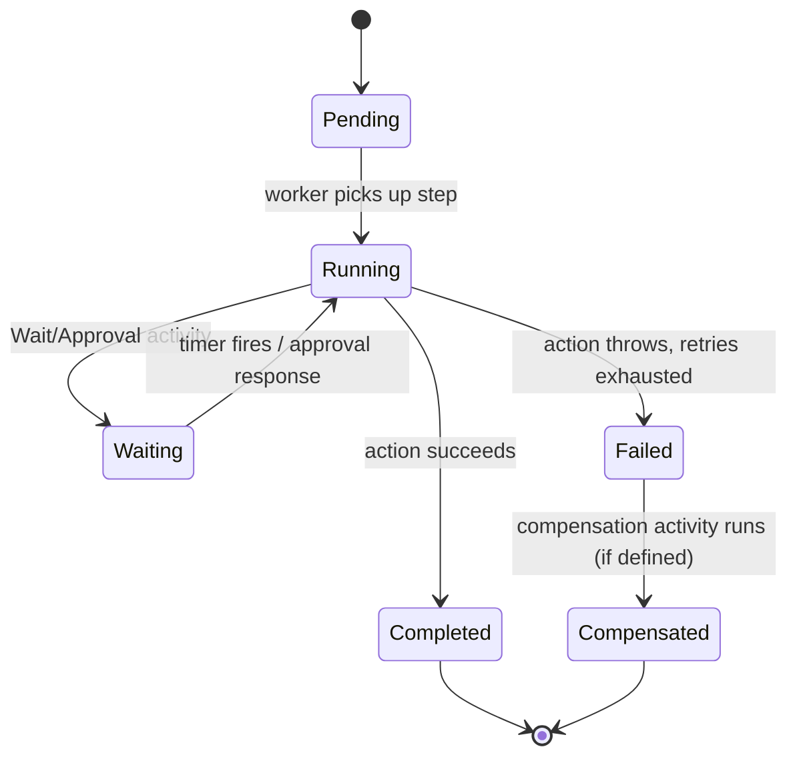

# Workflow Engine Architecture

**Phase:** 12 · Our own workflow engine, modeled on the *principle* behind
ServiceNow's Flow Designer (workflow-as-data, Phase 1/3 finding) — not a
port of its implementation.

> **Execution model superseded by `docs/adr/ADR-023-temporal-for-workflow-execution.md`:**
> the data-defined graph, activity vocabulary, and metadata-driven
> authoring described below are unchanged and remain authoritative.
> **§"Execution model"** — the `Host.Workers` polling/retry/timer machinery
> — is superseded: Temporal now provides durability, retries, timers
> (Wait), signals (Approval), and Sagas (Compensation), driven by a single
> generic `GraphExecutorWorkflow` that interprets these definitions at
> runtime. Read `ADR-023` for the full reconciliation before implementing
> this phase.

## Activity types

```
Trigger → Condition → Action → Approval → Wait → Event → Branch → Subworkflow
```

| Activity | Behavior | Notes |
|---|---|---|
| **Trigger** | Entry point: a domain event (`IncidentCreated`), a schedule (cron), or a direct API invocation | A workflow definition declares its trigger type; one definition = one trigger |
| **Condition** | Evaluates an expression against the workflow context (record fields, prior step outputs) | Server-evaluated only — never trusts a client-supplied condition result |
| **Action** | Calls into a domain context's Application-layer interface (e.g. "set Incident state to Resolved") or an integration endpoint | Actions never write directly to another context's database — same cross-context rule as `bounded-contexts.md` |
| **Approval** | Pauses execution, creates an Approval record, resumes on response | A shared activity type every domain reuses — not reimplemented per module (Phase 1 finding) |
| **Wait** | Pauses for a duration or until a condition becomes true (e.g. "wait until business hours") | Must be durable — survives an API process restart (see Execution model below) |
| **Event** | Emits a domain event for other consumers (workflow or otherwise) to react to | Decouples workflow completion from what happens next |
| **Branch** | Multi-path conditional continuation | Compiled to a directed graph, not nested if/else script |
| **Subworkflow** | Invokes another workflow definition as a step, awaiting its completion | Enables composition (e.g. "Standard Change" subworkflow reused inside multiple parent flows) instead of copy-pasted step sequences |

## Definition, version, instance, step

```sql
CREATE TABLE workflow_definition (
    id UUID PRIMARY KEY,
    tenant_id UUID NOT NULL,
    name TEXT NOT NULL,
    trigger_type TEXT NOT NULL,
    graph JSONB NOT NULL,          -- versioned activity graph (nodes + edges)
    version INT NOT NULL,
    is_active BOOLEAN NOT NULL DEFAULT true,
    created_at TIMESTAMPTZ NOT NULL DEFAULT now()
);

CREATE TABLE workflow_instance (
    id UUID PRIMARY KEY,
    tenant_id UUID NOT NULL,
    definition_id UUID NOT NULL REFERENCES workflow_definition(id),
    definition_version INT NOT NULL,      -- pinned at start; a running instance never silently jumps versions
    source_table TEXT NOT NULL,
    source_id UUID NOT NULL,
    correlation_id UUID NOT NULL,
    status TEXT NOT NULL,                 -- Running, Completed, Failed, Cancelled
    started_at TIMESTAMPTZ NOT NULL DEFAULT now(),
    completed_at TIMESTAMPTZ
);

CREATE TABLE workflow_step (
    id UUID PRIMARY KEY,
    instance_id UUID NOT NULL REFERENCES workflow_instance(id),
    node_id TEXT NOT NULL,                -- node id within the definition's graph
    status TEXT NOT NULL,                 -- Pending, Running, Waiting, Completed, Failed, Compensated
    attempt_count INT NOT NULL DEFAULT 0,
    scheduled_for TIMESTAMPTZ,            -- for Wait steps and retry backoff
    input JSONB,
    output JSONB,
    error TEXT,
    idempotency_key TEXT NOT NULL,
    UNIQUE(instance_id, node_id, attempt_count)
);
```

**A running instance pins its `definition_version`** at start — editing a
workflow definition never alters in-flight instances, only new ones. This
prevents the class of bug where an admin edits an approval flow and every
currently-pending approval silently changes shape mid-execution.

## Execution model



- Step execution happens in `Host.Workers` (satellite, per `microservice-boundary-rules.md`
  decision on Workflow: evaluation stays close to the core for context access,
  but **timers and retries run in workers** so they survive API process
  restarts) — a `Wait` step's due time and a retrying `Action` step's next
  attempt are both durable rows (`scheduled_for`), polled/dispatched by a
  worker, not held in server memory.
- **Retry:** exponential backoff with a bounded max attempt count per step,
  configurable per activity, default 5 attempts.
- **Timeout:** every `Action`/`Approval`/`Wait` step has a max duration;
  exceeding it transitions to `Failed` (or a configured "escalate" branch)
  rather than hanging indefinitely.
- **Compensation:** an activity may declare a compensating action (e.g. "if
  the downstream provisioning call succeeded but a later step failed, call
  the deprovisioning endpoint"). Compensation is explicit per-step, not an
  automatic global rollback — distributed workflows cannot be wrapped in a
  database transaction, so compensation is the only sound consistency tool
  (Master AI Command Rule 9/10).
- **Idempotency:** every step execution carries an `idempotency_key`
  (deterministic from `instance_id` + `node_id` + `attempt_count`); any
  Action calling an external or internal API includes this key so a retried
  step never double-executes a side effect (e.g. never sends a duplicate
  approval notification).
- **Scheduling:** cron-triggered definitions are dispatched by a scheduler
  in `Host.Workers`, itself tenant-partitioned (never a single global scan
  across all tenants at once — matches the original guide's tenancy
  principle).

## Human approval and escalation

- `Approval` activity creates a durable Approval record, notifies the
  approver(s) via the Notification platform, and the instance transitions to
  `Waiting`.
- **Escalation** on an unanswered approval reuses the exact same
  Group/Shift/Escalation-Timeline machinery as
  `docs/architecture/09-notification-oncall-escalation-engine.md` — a
  workflow does not implement its own escalation clock.

## Business Rules vs. Workflow — where the line is

Full guidance in `docs/workflow/business-rule-engine.md` (Phase 13); the
short version: **Workflow is for multi-step, potentially long-running,
human-involving process** (approval, wait, orchestration across contexts).
**Business Rules are for synchronous, record-scoped logic** (validation,
defaulting, single-table side effects) that must complete within the same
request/transaction. Putting long-running logic in a Business Rule, or
putting simple field validation in a Workflow, are both named anti-patterns.

---

*Next: `docs/workflow/business-rule-engine.md` (Phase 13).*
